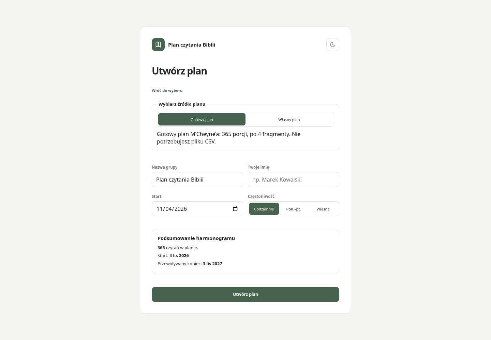
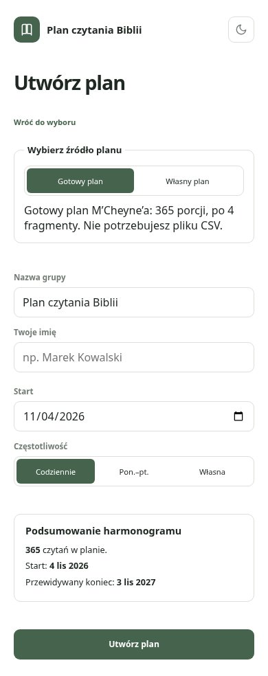
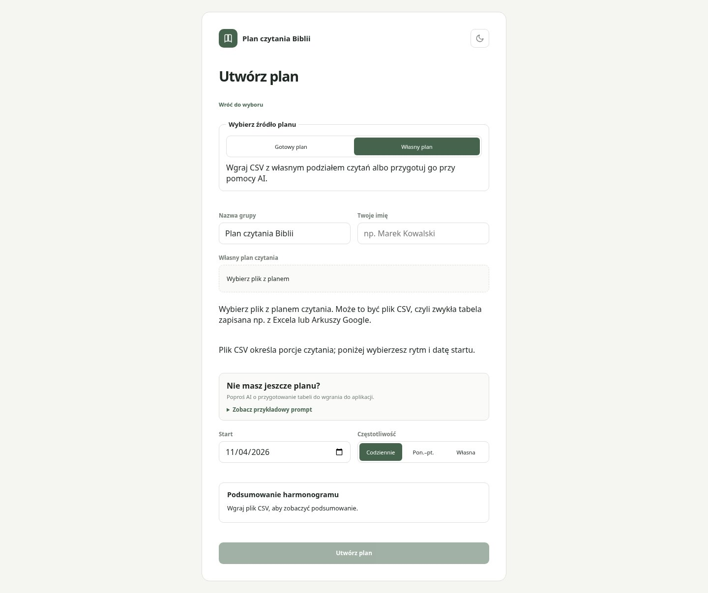
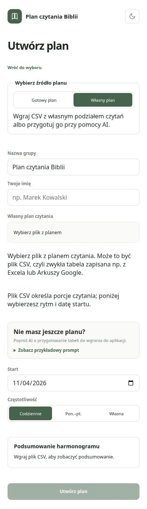
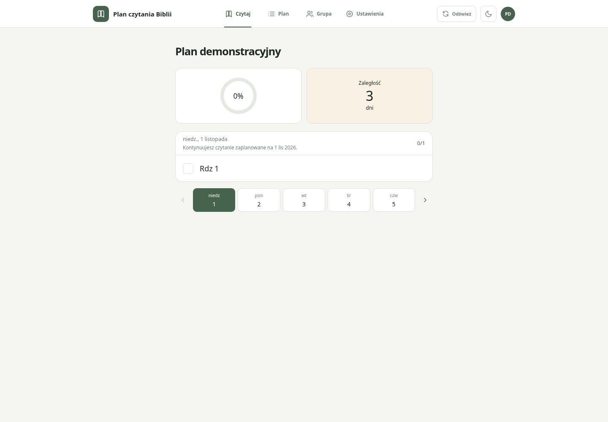
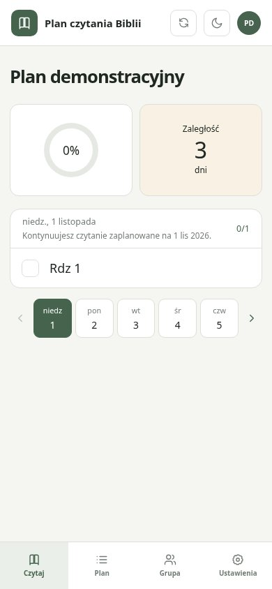
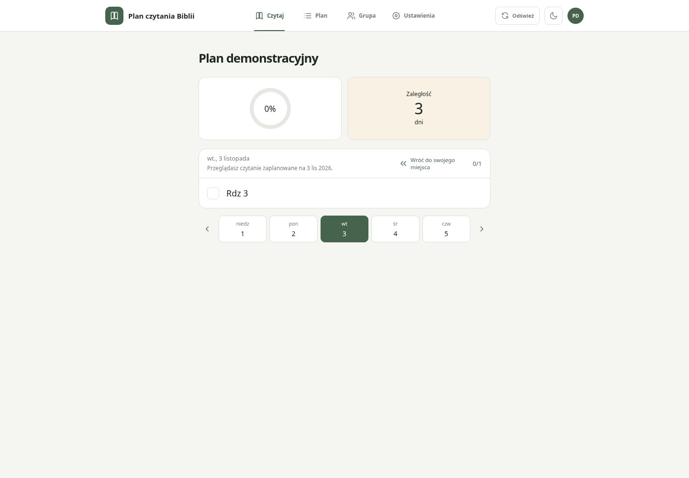
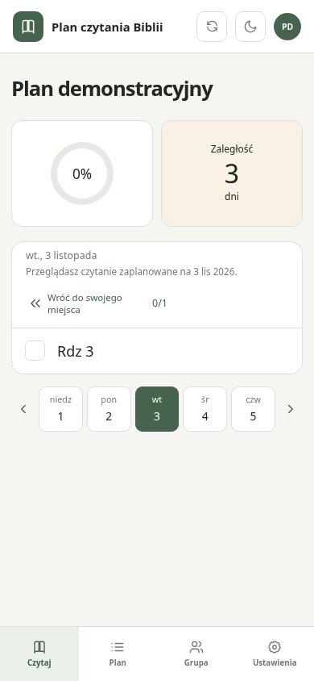
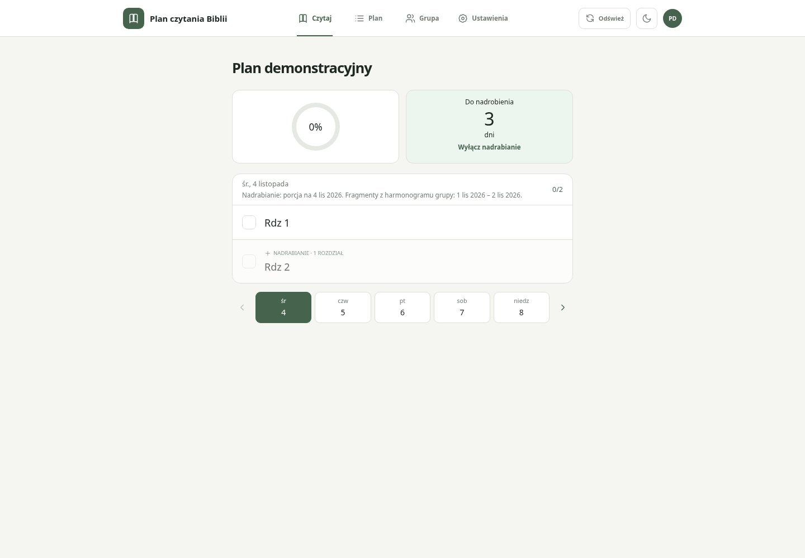
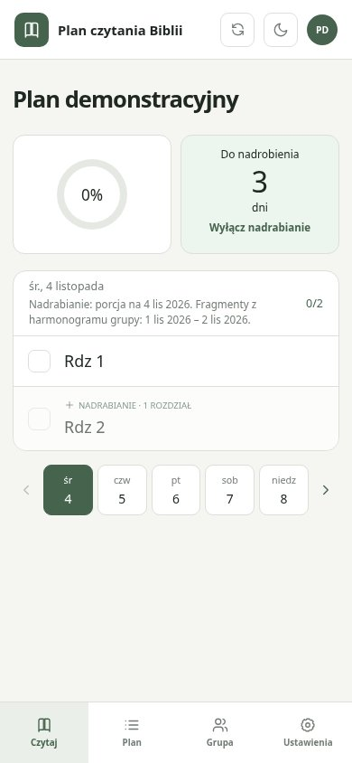

# Zrzuty ekranu #8 i #10

Źródłowy develop: `4ca39ed11b2c9815a8b9e679e6b51150a81899a7`. Rzeczywista aplikacja uruchomiona w lokalnym Vite z kompletnymi plikami zmienionymi na develop względem main. Chromium / Playwright, 1440×1000 i 390×844, Europe/Warsaw, 2026-11-04. Wyłącznie syntetyczne dane i wbudowany lokalny magazyn aplikacji. To dokumentacja UI, NIE potwierdzenie działania produkcyjnego backendu ani zapisujące E2E. Nie wykonywano zapisów produkcyjnych/preview.

Lokalnie: npm test success (21 testów Node, 335 Vitest / 43 pliki); npm run build success. Testy uruchomiono ponownie po ograniczeniu procesów w sandboxie. Capture sprawdził pojawienie się przycisku powrotu po wybraniu d2 i powrót do 2026-11-01. Pozostałe obrazy dokumentują widoki bez deklaracji pełnej weryfikacji funkcjonalnej. Zrzuty pokazują stan po zmianie; brak zestawu przed/po. Po kolejnych zmianach UI należy odświeżyć obrazy. Produkcyjne E2E nadal failure — blokada #24.

## Screenshots / Zrzuty ekranu

