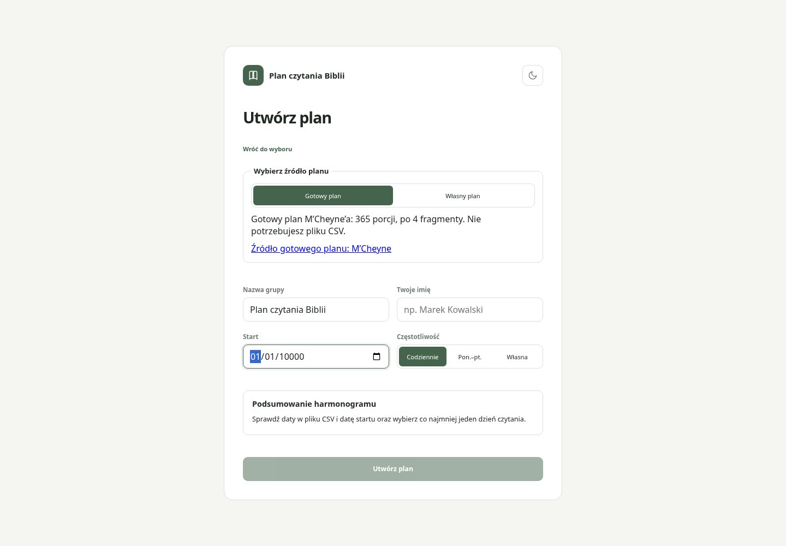
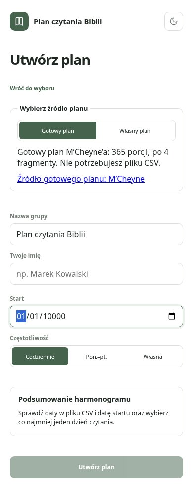

# Issue #10 — aktualny widok po drugiej rundzie poprawek

Rzeczywisty Chromium lokalnej aplikacji z kodem z tego commita, desktop 1440×1000 i mobile 390×844, syntetyczne dane. Odświeżono wszystkie widoki; obrazy niezmienionego UI mają takie same bajty. Dodano komunikat dla daty 10000-01-01. Pomoc CSV domyślnie zwinięta. To dokumentacja wizualna, nie test produkcyjnego backendu; nie wykonywano zapisujących E2E.

Lokalnie npm test success: 21 testów Node i 338 Vitest / 43 pliki; npm run build success. Regresje obejmują datę z pięciocyfrowym rokiem, nieistniejący dzień miesiąca i opóźniony FileReader po zmianie źródła. Scenariusze E2E zaktualizowano; nie uruchomiono ich poza autoryzowanym pipeline main.

