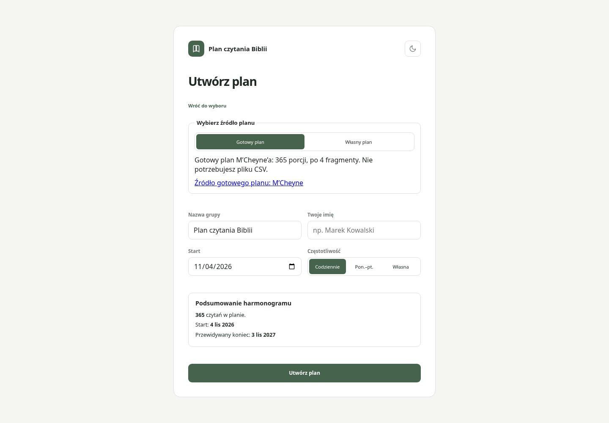
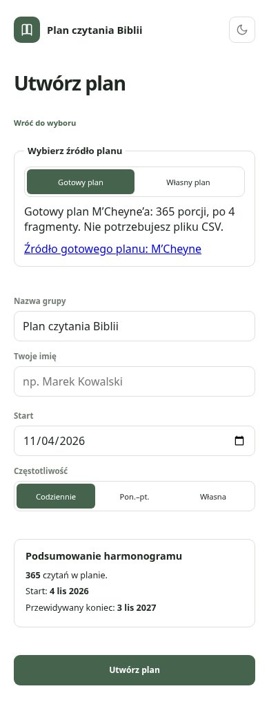
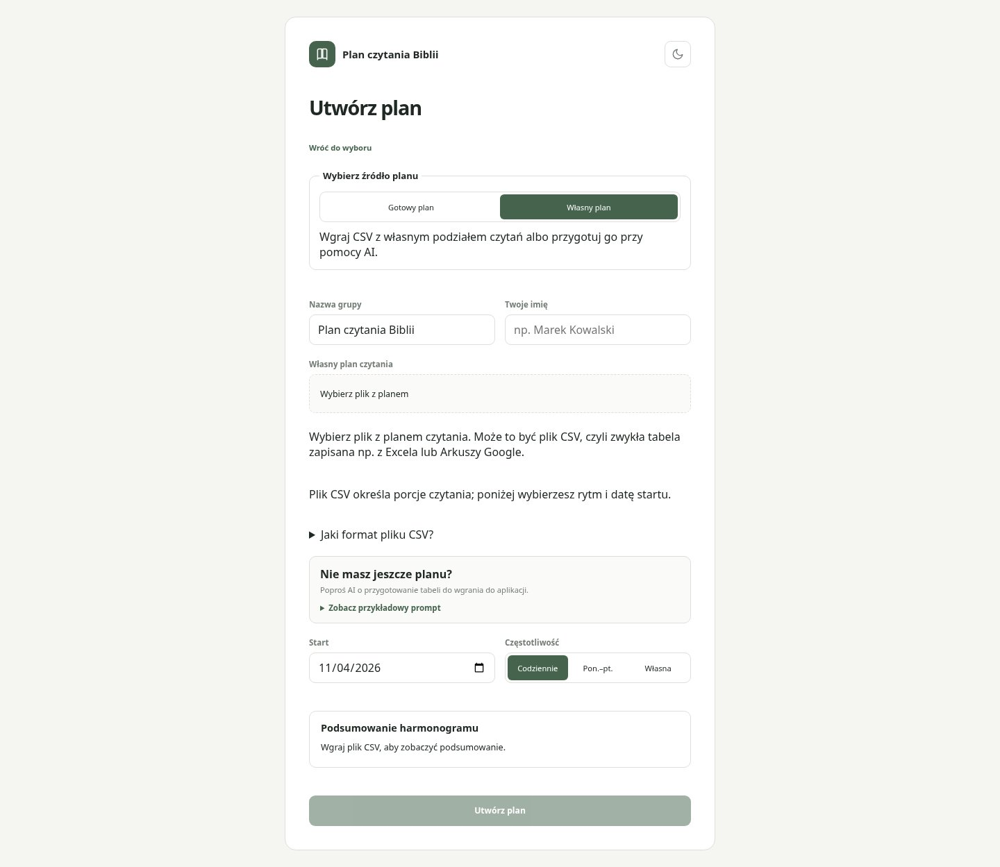
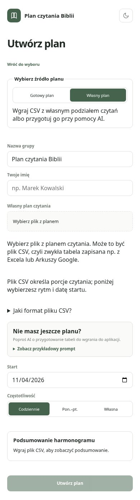
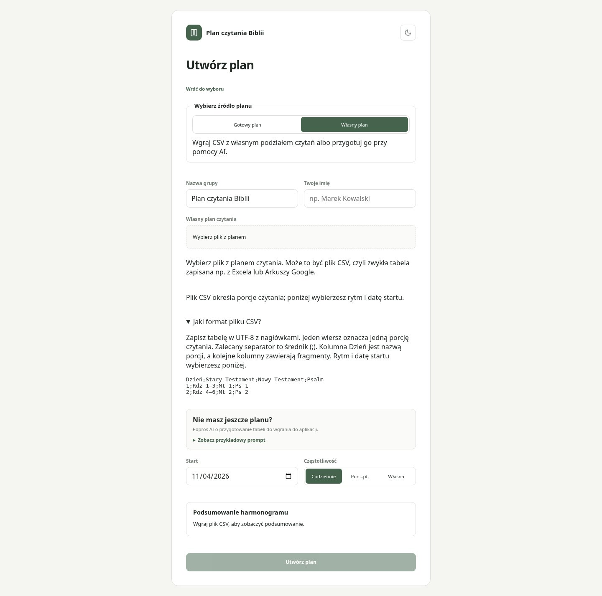
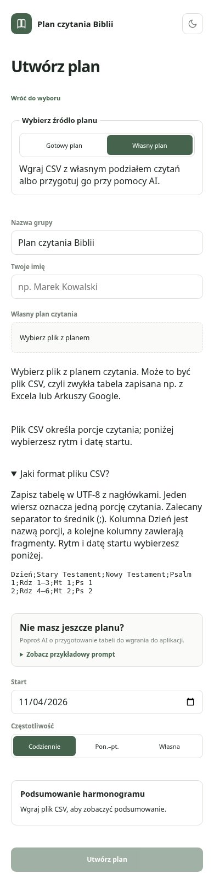

# Issue #10 — aktualny widok

Rzeczywisty Chromium lokalnej aplikacji, desktop 1440×1000 i mobile 390×844. Syntetyczne dane; nie wykonywano zapisujących E2E ani operacji produkcyjnych. Zrzuty wykonano z kodu aplikacji w tym commicie (zmiany #8 wycofano). Gotowy plan zawiera źródło; struktura CSV jest domyślnie zwinięta i dostępna po rozwinięciu. Lokalnie testy i build sprawdzono; CI i review wymagają osobnej weryfikacji.

