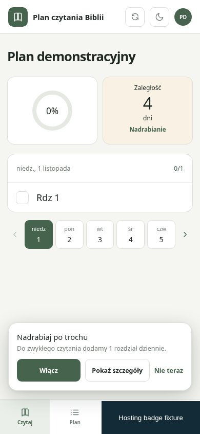
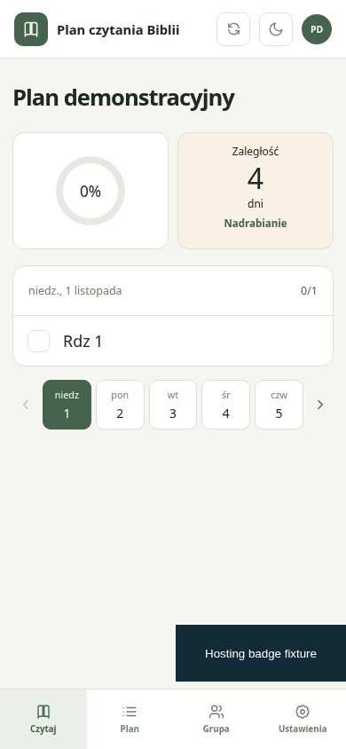
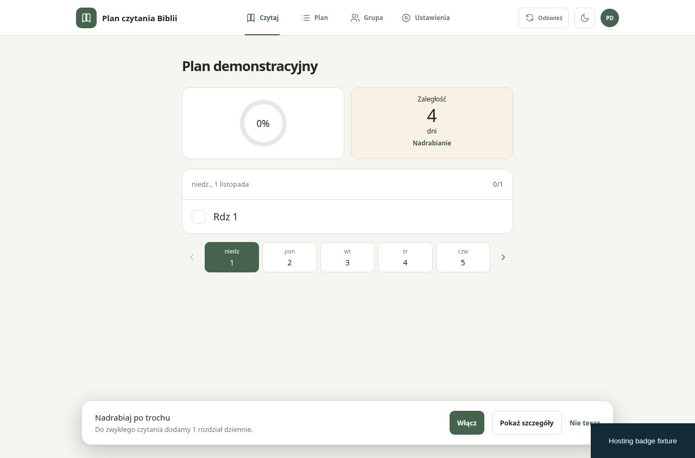
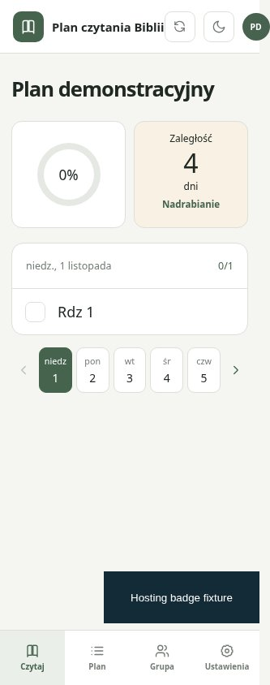

# #24 — hosting badge and mobile navigation

Actual app rendered by Chromium, synthetic local plan. Before uses CSS from b5682e5; after uses this commit's CSS. Local-only storage, NOT deployed-backend E2E. The hosting iframe is a clearly labelled regression fixture reproducing the 192×64 bottom-right geometry of the Netlify overlay from the failed run; screenshots are real browser captures, not generated mockups or captures of production Netlify branding.

Verified: before at 390px the iframe overlaps navigation and a normal Settings click times out. After at 320, 390 and 700px all four tabs can be clicked, the recovery prompt's Not now button can be clicked, and the badge itself remains clickable. Desktop 1280px remains unchanged. The iframe moves above mobile tabs; its stacking level stays below application notices/dialogs, without disabling pointer events or hiding the badge. Extra page padding lets content scroll clear of the fixed badge.

npm test: 21 Node + 338 Vitest passed; npm run build passed. Added backend E2E mobile-navigation regression using the real platform iframe if available, or a same-size hosting-overlay fixture otherwise; no API responses are mocked. Full writable E2E only in the authorized main pipeline. Existing 14 failed scenarios are retained; the onboarding timeout must be confirmed by that next full run. Do not claim production E2E success from local reproduction.

