# Osobiste dni czytania (#28)

Rzeczywista aplikacja uruchomiona lokalnie w Chromium: desktop 1440×1000,
mobile 390×844, pl-PL, Europe/Warsaw. Syntetyczny plan z trzema pulami po 12
rozdziałów, profil demonstracyjny. Stan „pending” to jawnie zasiany lokalny
fixture oczekującego ustawienia od 16 listopada; nie jest dowodem zapisu backendu.
Nie wykonano writable E2E ani zapisów produkcyjnych. Lokalna karta powiadomień
pokazuje niedostępność backendu; nie ukrywano tego stanu na screenshotach.

Zrzuty „before” wykonano z kodu bazowego #26, SHA
97f23b6b1c1356424b8d677ae79c115ab0cd0366. Pozostałe odpowiadają kodowi tego commita.
Daty przykładów są syntetyczne; aplikacja i endpoint wyliczają je dynamicznie.

| Stan | Desktop | Mobile |
|---|---|---|
| Ustawienia przed | 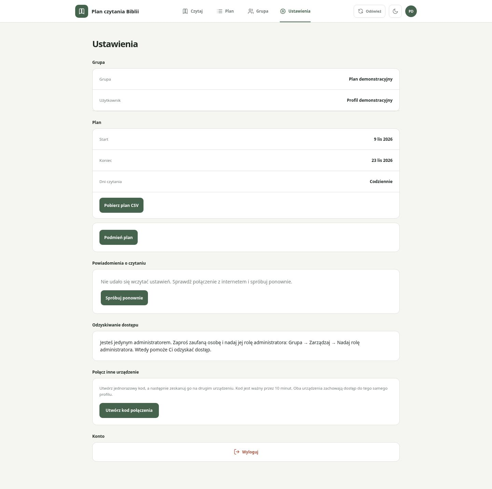 | 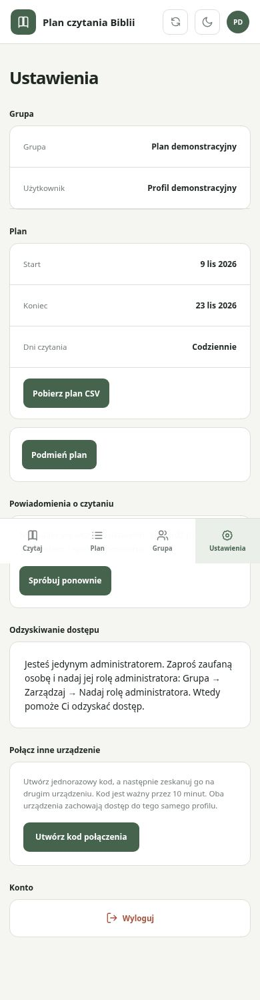 |
| Ustawienia po | 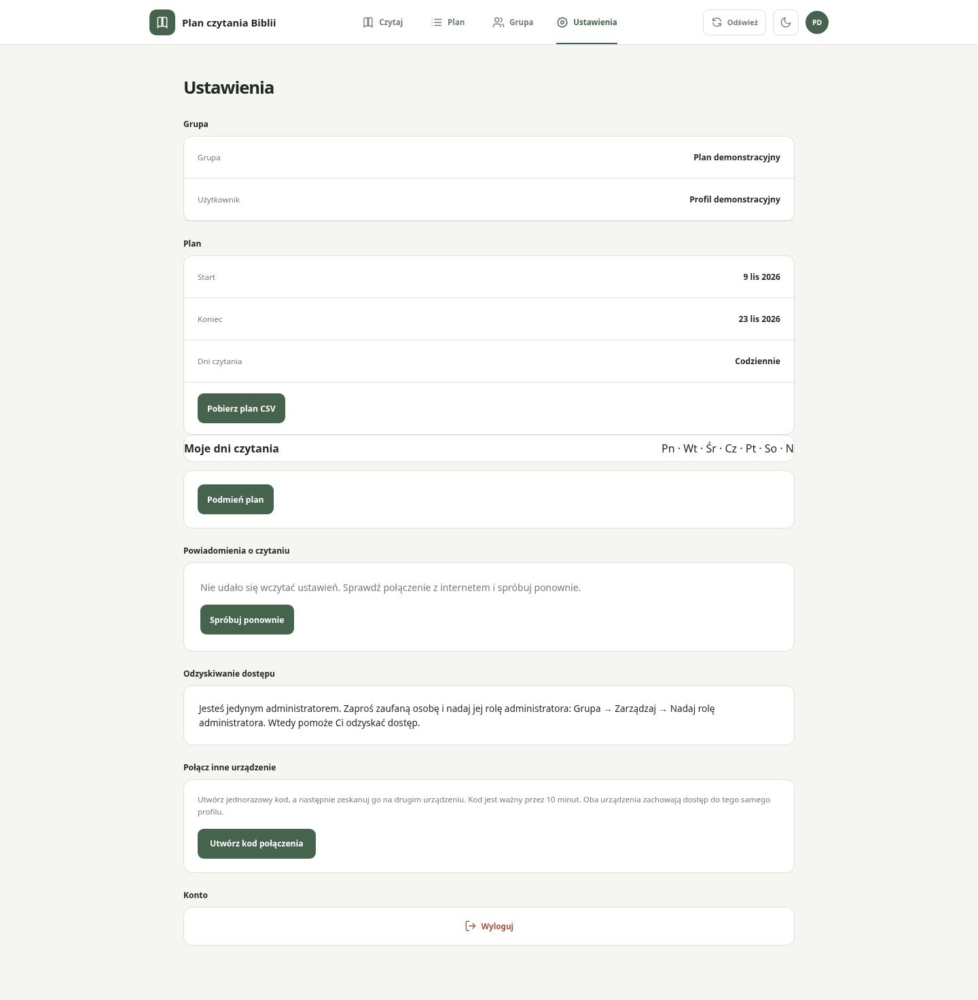 | 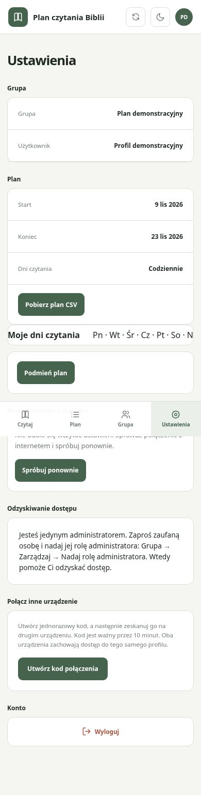 |
| Edytor — podgląd zwinięty | 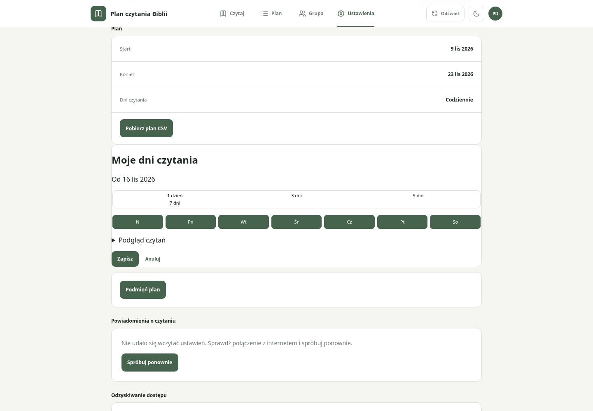 | 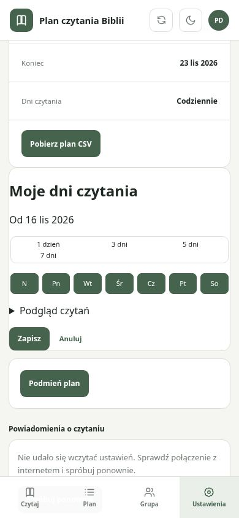 |
| Podgląd 3 dni | 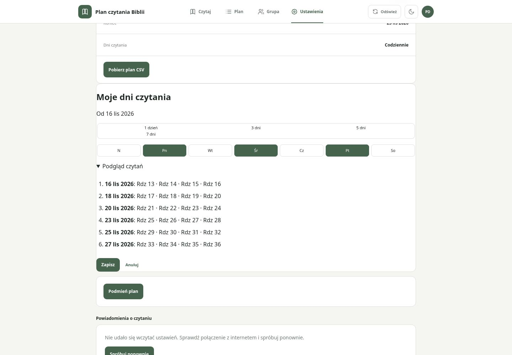 | 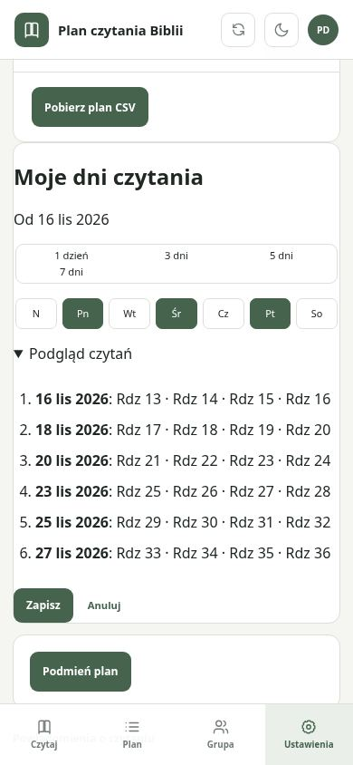 |
| Brak wybranych dni | 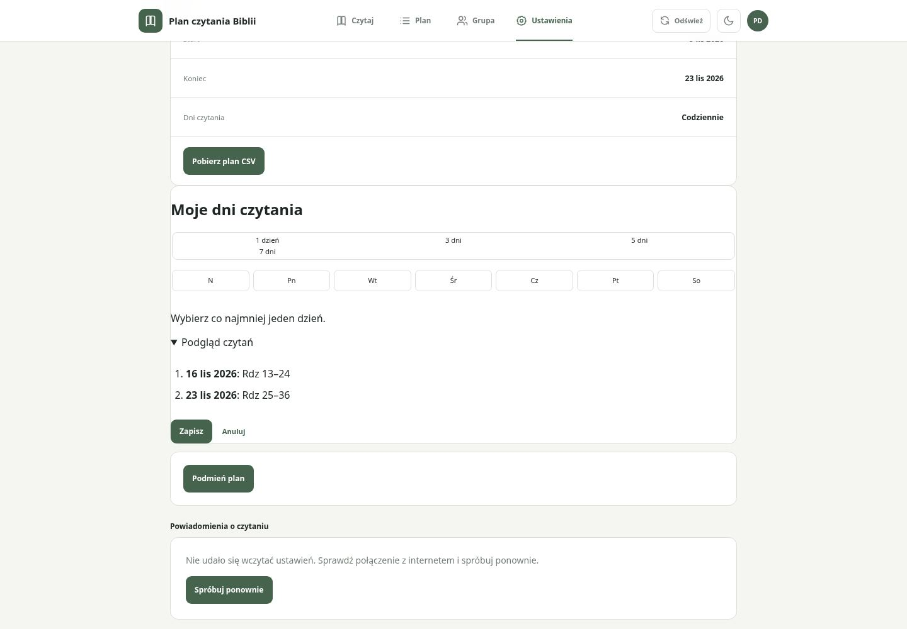 | 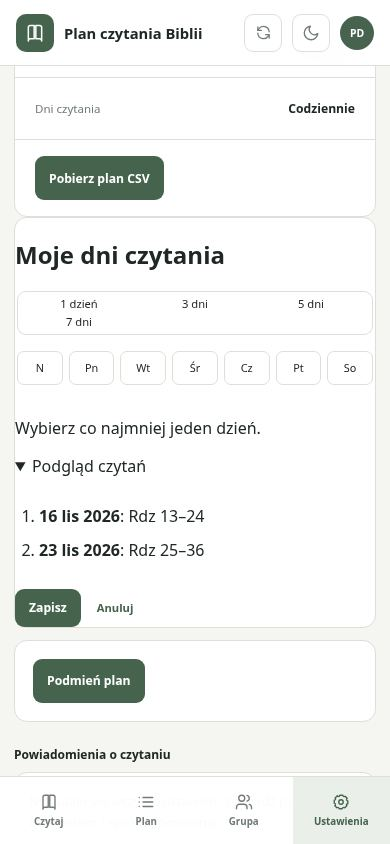 |
| Oczekująca zmiana | 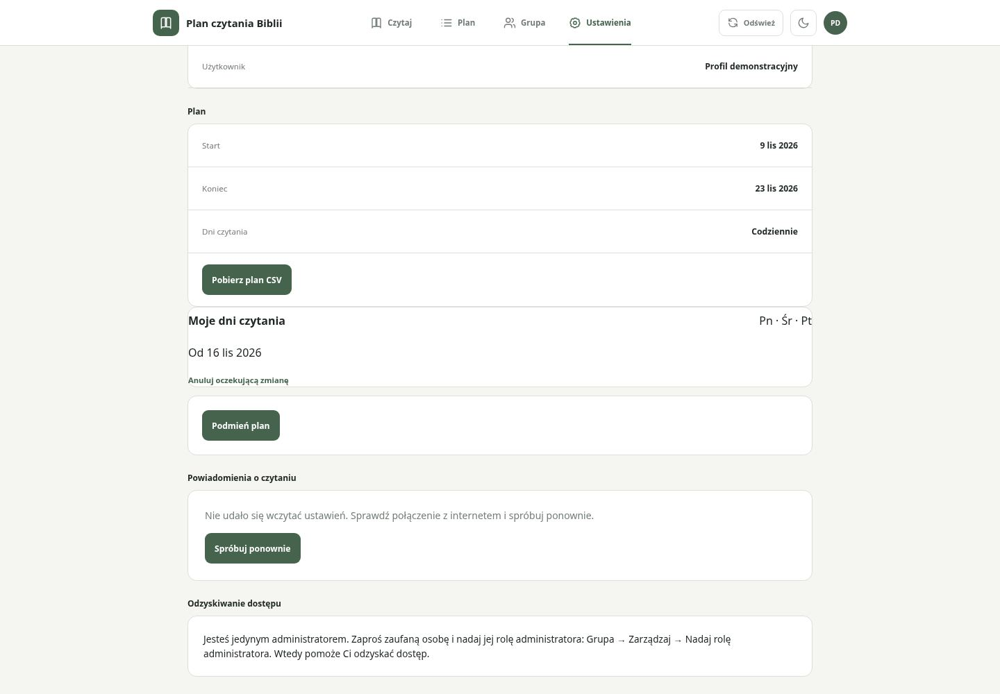 | 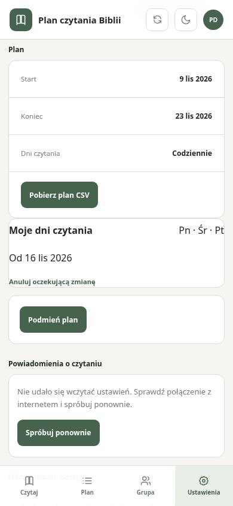 |
| Kontrola Czytaj | 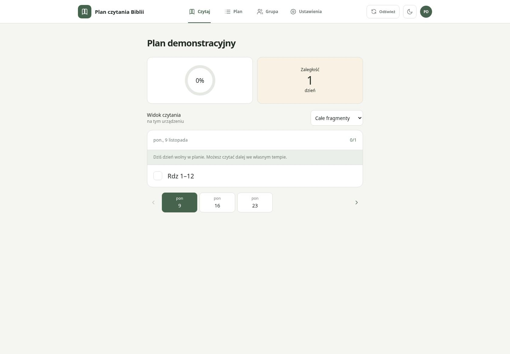 | 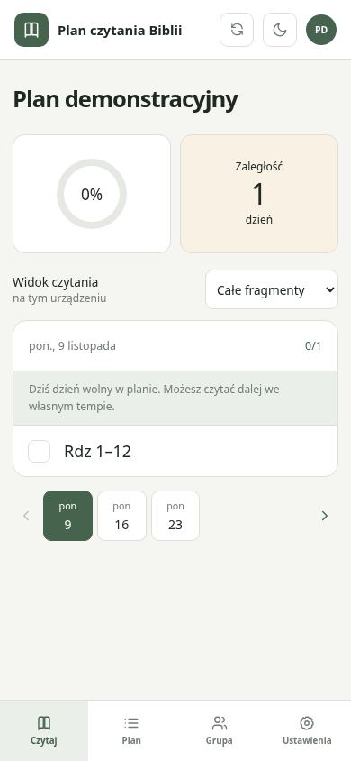 |
| Kontrola pełnego Planu | 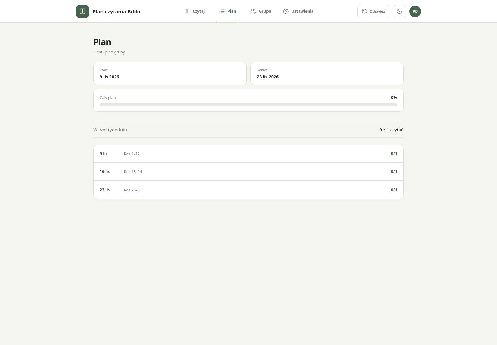 | 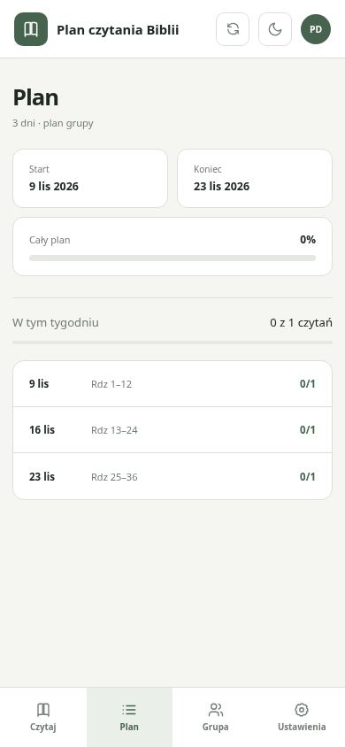 |
| Kontrola Grupy | 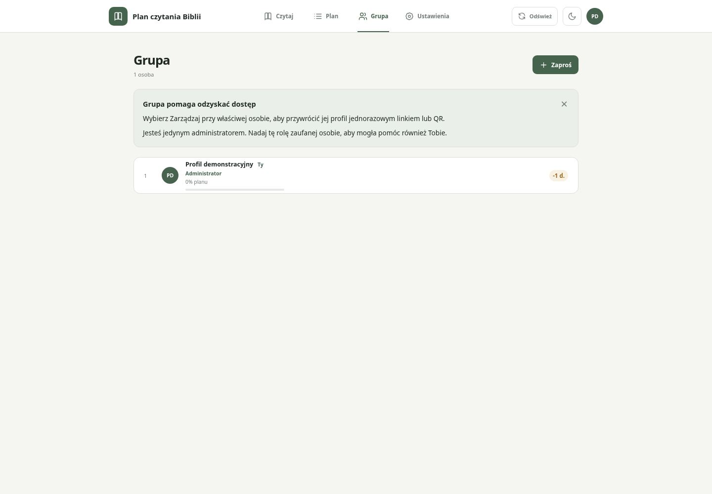 | 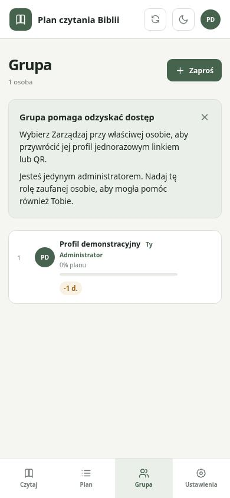 |

Reprodukcja: npm run dev na porcie 5173 (istniejący tryb lokalny), wyłącznie
syntetyczny plan w local-store, następnie Ustawienia → Moje dni czytania.
Rozwiń Podgląd czytań; wybierz 1 dzień i odznacz sobotę, aby obejrzeć błąd zera dni.
W backendzie zapis sprawdzają lokalne testy handlera ze sztucznym magazynem.
Przygotowano E2E realnego API, dwóch urządzeń, stale-write i anulowania;
wykona je wyłącznie istniejący pipeline po main. Nie deklarujemy ich zaliczenia.

Lokalna weryfikacja: 21 testów Node + 404 Vitest w 47 plikach oraz build — success.
