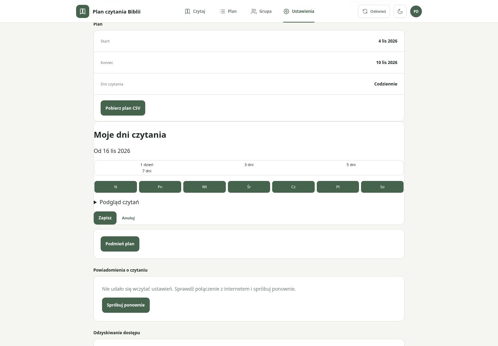
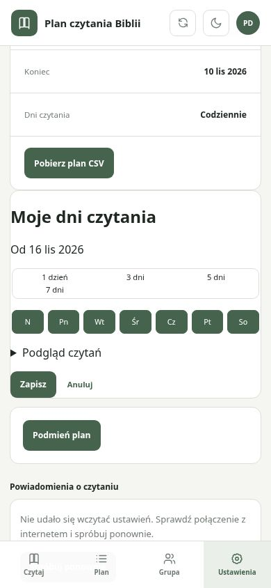
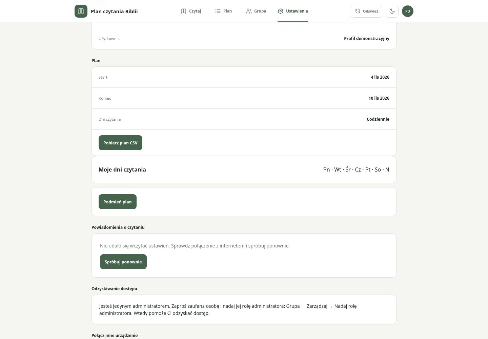
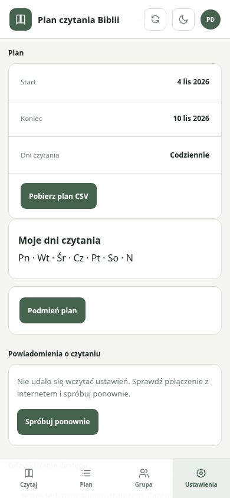
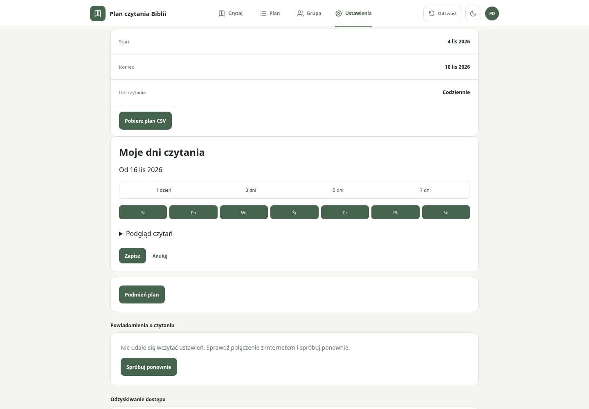
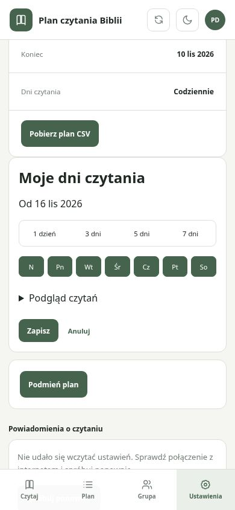
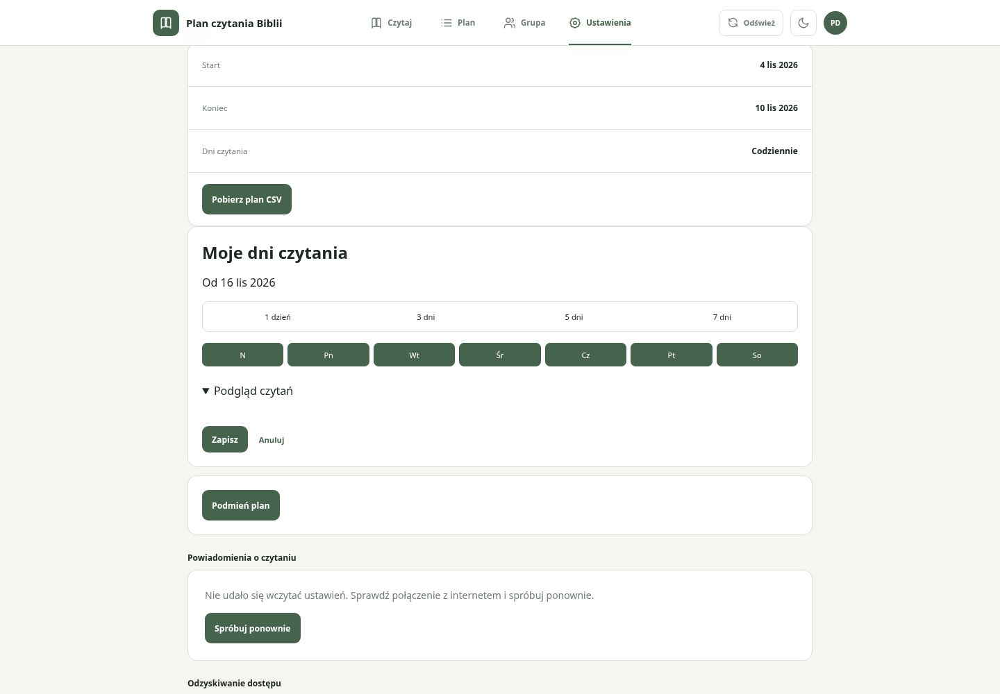
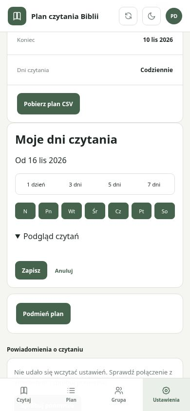

# Poprawka układu „Moje dni czytania” (#28)

Odpowiedź na komentarz właściciela z 11 listopada 2026, 10:02:05 UTC.
Baza przed zmianą: f00cc55ce8ec4513bd569a5fd10afe20ead47b9e.
Zrzuty po zmianie odpowiadają kodowi commita zawierającego ten dokument.

Rzeczywista lokalna aplikacja uruchomiona w Chromium na porcie 4173.
Syntetyczny profil i plan, bez zapisów do backendu i bez rzeczywistych danych.
Lokalna karta powiadomień pokazuje brak backendu; nie ukrywano jej ani nawigacji.
Kadry przewinięto zwykłym scrollIntoView, aby zmienione kontrolki były widoczne
między nagłówkiem a stałą nawigacją. Desktop 1440×1000, mobile 390×844.

| Stan | Desktop | Mobile |
|---|---|---|
| Edytor przed |  |  |
| Karta po |  |  |
| Edytor po |  |  |
| Podgląd po |  |  |

Poprawka: padding 20 px na desktopie / 16 px na małych ekranach, cztery
skróty tempa w jednym rzędzie o automatycznej wysokości, osobny rząd dni,
odstępy tytułu/podglądu/przycisków, zawijanie opisu dni. Dodatkowo tytuł
w nagłówku może zawinąć się przy małej szerokości bez wypychania narzędzi.
Weryfikacja geometrii przeszła dla 1440, 390 i 320 px: padding >=16 px,
skróty w jednym rzędzie i wewnątrz karty, nad przyciskami dni, brak poziomego
przepełnienia dokumentu. Nie zmieniono działania harmonogramu ani endpointu.

Lokalnie: 21 testów Node, 404 Vitest w 47 plikach i npm run build — sukces.
E2E rozszerzono o pomiary układu i viewport 320 px; niewykonane, pozostają
w istniejącym pipeline po main. Zrzuty nie dowodzą działania backendu.
