# Wydanie #28 — aktualna dokumentacja wizualna

Capture 12 listopada 2026 z rzeczywiście uruchomionej aplikacji Chromium,
desktop 1440×1000 / mobile 390×844, pl-PL, Europe/Warsaw, localhost:4173.
Obrazy odświeżono na kodzie z poprawkami trzeciej rundy review PR #31
(zawartymi w tym samym commicie). Szesnaście podstawowych kadrów po ponownym
uruchomieniu pozostało identycznych; dwa pokazują poprawione daty
sobotniego nadrabiania. W tym scenariuszu zegar przeglądarki ustawiono jawnie
na 5 grudnia 2026; następna porcja ma datę sobota, 12 grudnia.

Dwa kolejne obrazy legacy-migration pokazują migrację lokalnego prefiksu
(s0: 1) i rzadkiego odznaczenia (s0: [2]) do widocznych Rdz 1 i 3. Osobiste
dni były zapisane wcześniej na uczestniku. To prawdziwa lokalna ścieżka
aplikacji, bez podszywania się pod odpowiedź produkcyjnego API.

Wyłącznie syntetyczny plan z trzema pulami po 12 rozdziałów, bez danych
użytkowników, tokenów dostępu lub linków zaproszeniowych na obrazach.
Stan Czytaj/Plan/Grupa korzysta z jawnego lokalnego fixture osobistego tempa
pon./śr./pt. od 16 listopada. Pending jest osobnym fixture zmiany od tej daty,
z wcześniejszym startem planu. Nie są dowodami zapisu do backendu. Nie wykonano
zapisujących E2E poza pipeline po main ani nie zmieniano produkcyjnych danych.
Nie ukrywano karty powiadomień z niedostępnym lokalnie backendem ani nawigacji.
Karty przewijano zwykłym scrollIntoView, aby kontrolki były czytelne.

| Stan | Desktop | Mobile |
|---|---|---|
| Pozycja w ustawieniach | 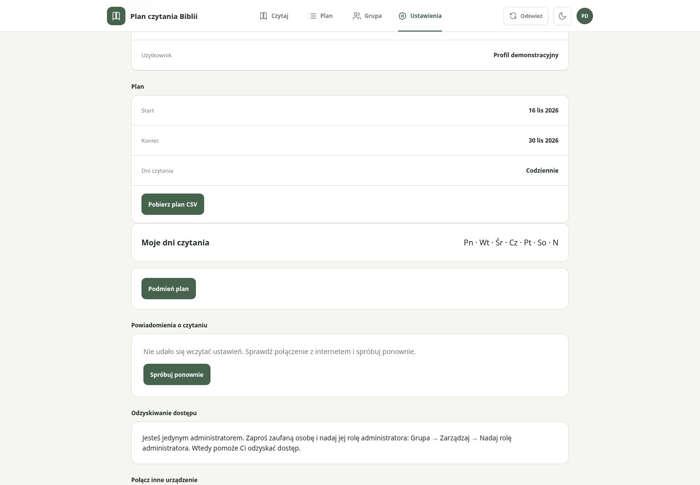 | 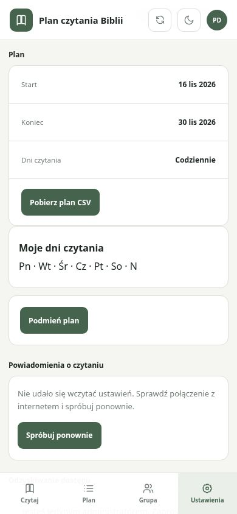 |
| Edytor 3 dni, podgląd zwinięty | 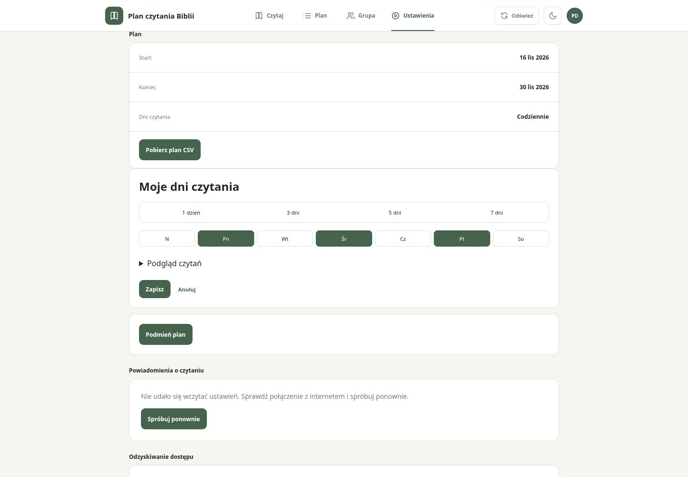 | 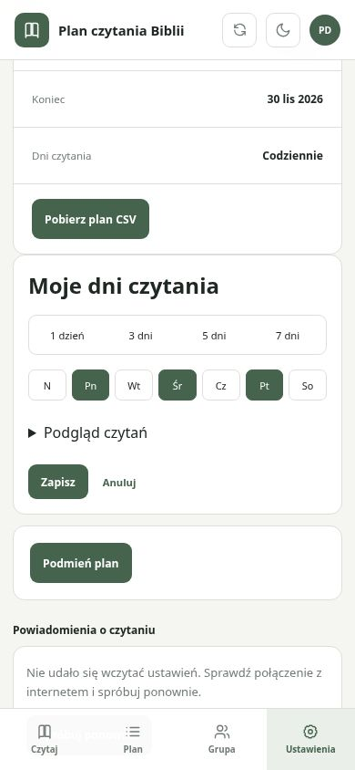 |
| Podgląd rzeczywistych dat i porcji | 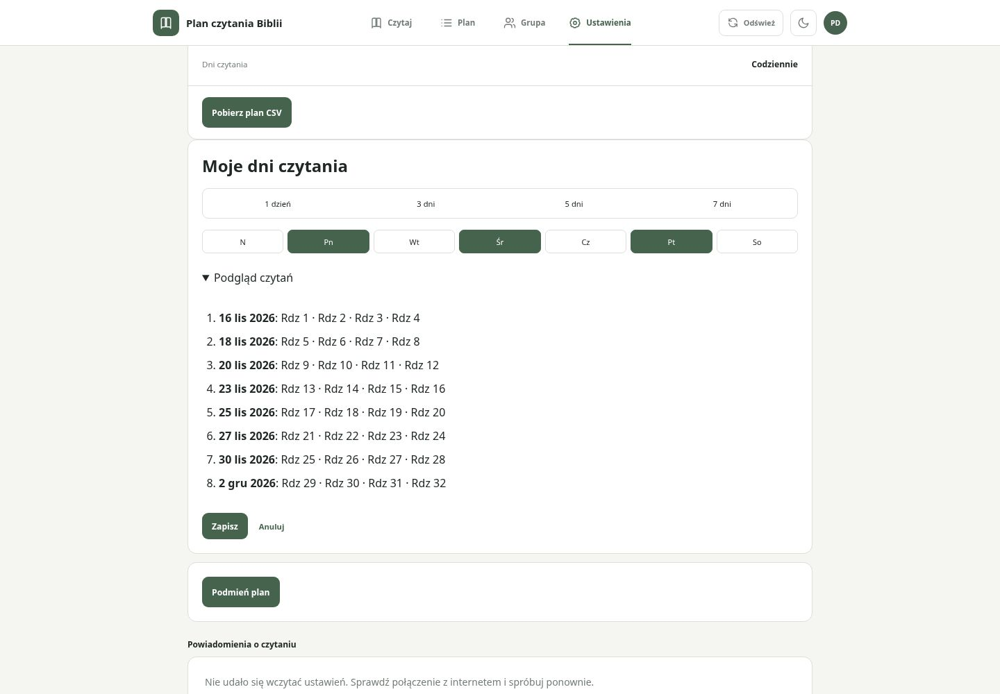 | 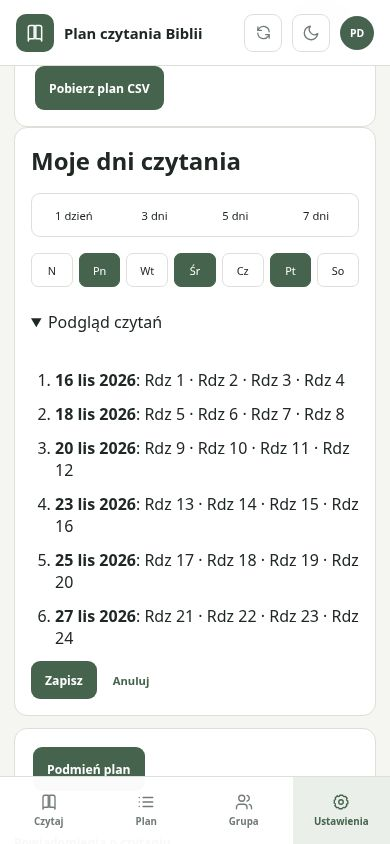 |
| Brak wybranych dni — walidacja | 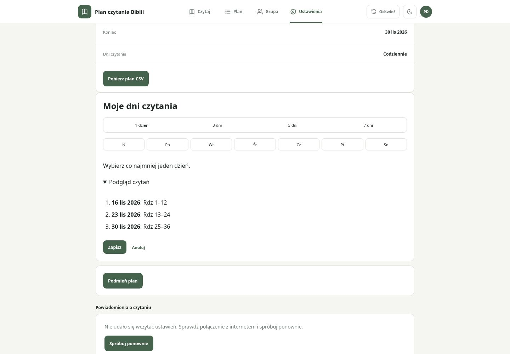 | 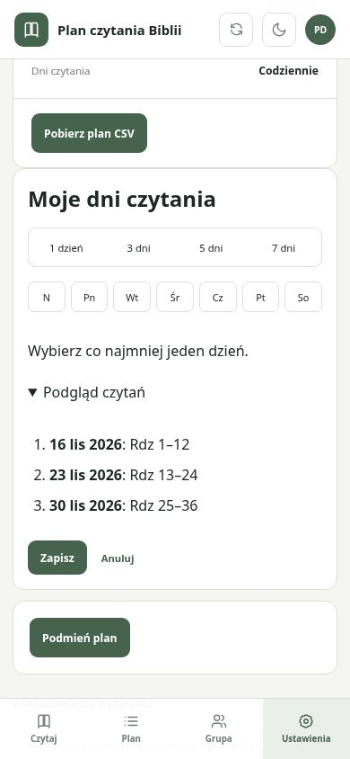 |
| Oczekująca zmiana | 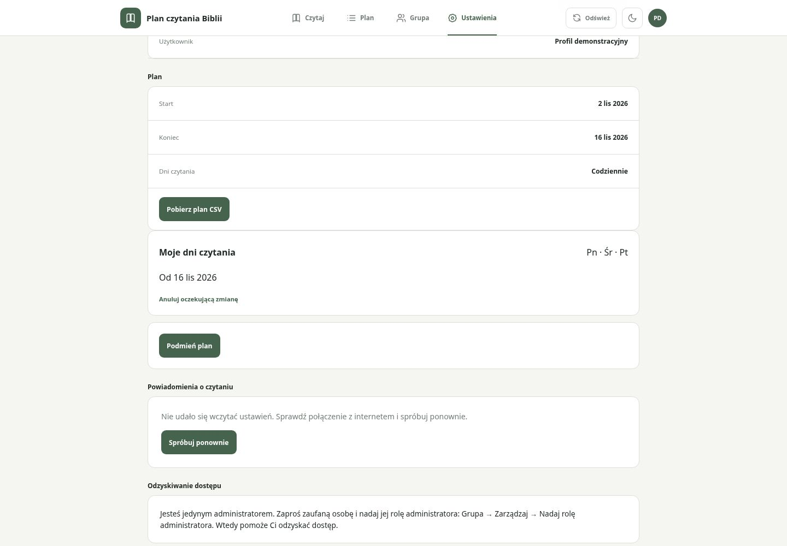 | 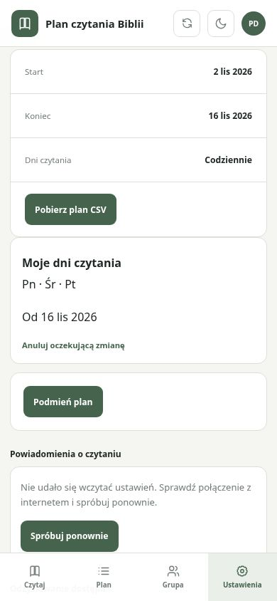 |
| Czytaj — osobista porcja | 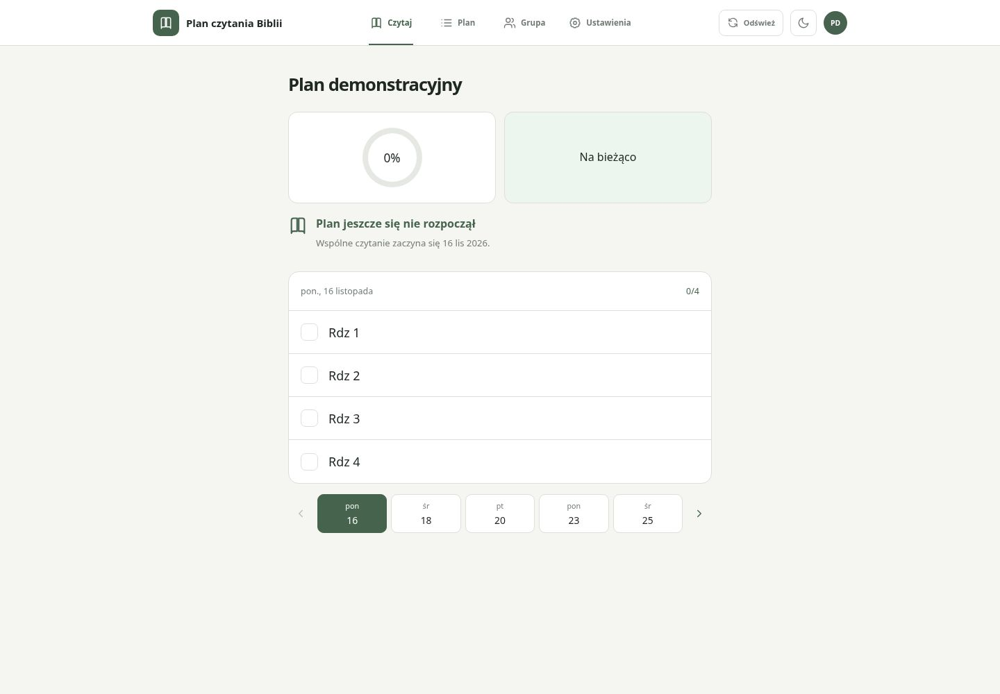 | 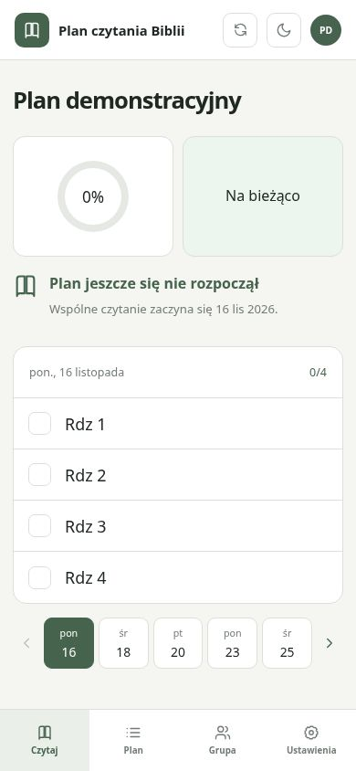 |
| Pełny Plan grupy | 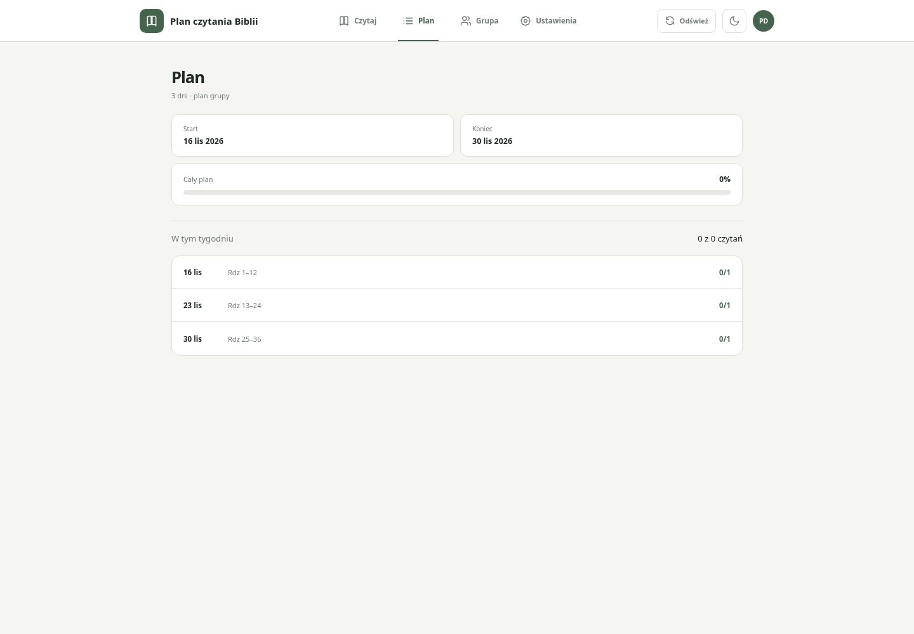 | 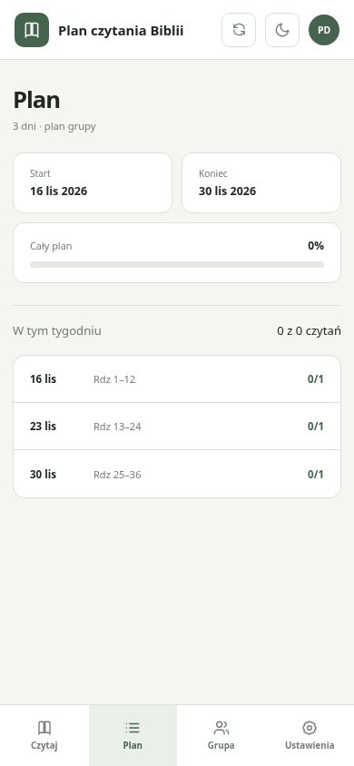 |
| Nadrabianie — kolejna osobista sobota | 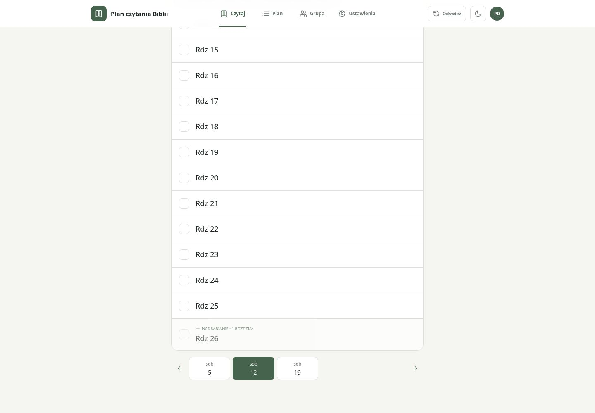 | 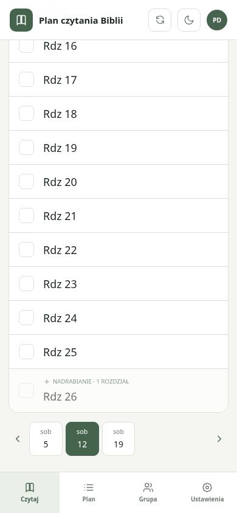 |
| Migracja lokalnych odznaczeń | 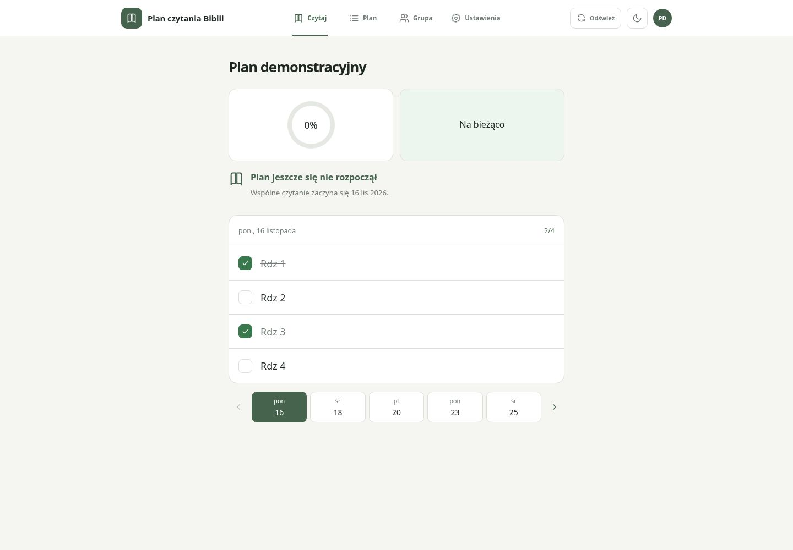 | 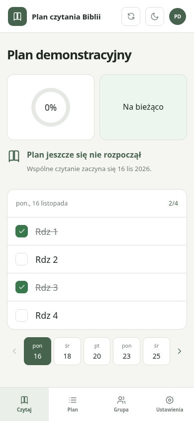 |
| Grupa — dotychczasowy układ | 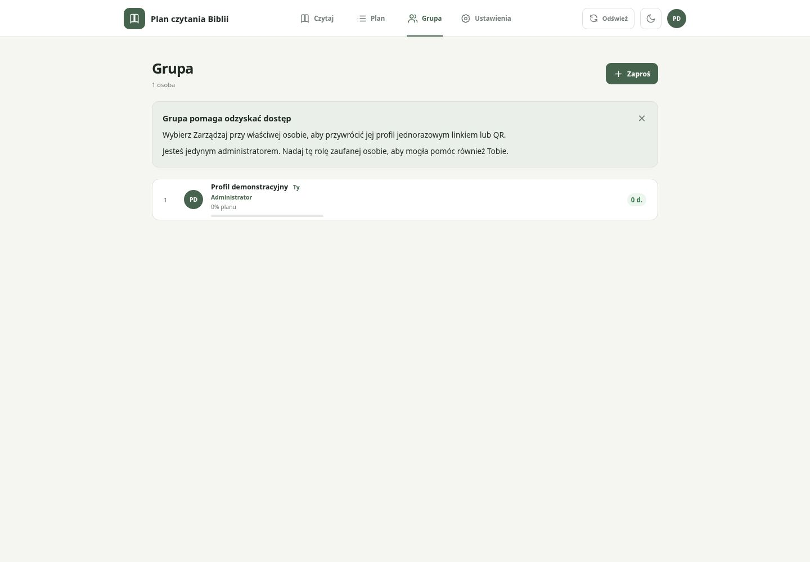 | 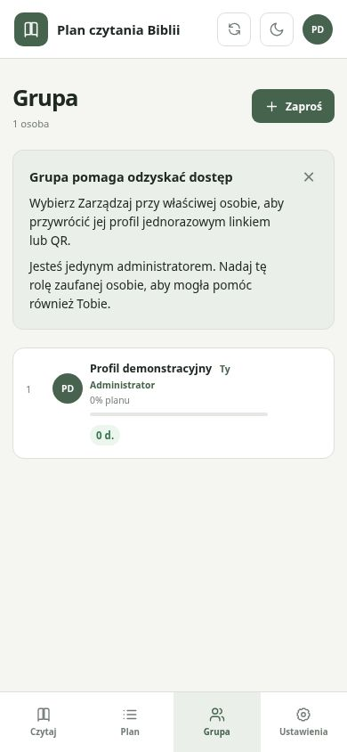 |

Wiarygodne obrazy przed wdrożeniem funkcji: ../before-desktop.jpg oraz
../before-mobile.jpg (baza #26, SHA 97f23b6b1c1356424b8d677ae79c115ab0cd0366).
Przed/po korekty paddingu: ../layout-fix/README.md; aktualne kadry powyżej.

Sprawdzono brak poziomego overflow, minimum 16 px paddingu, cztery skróty
w jednym rzędzie i brak nakładania na przyciski dni na obu viewportach.
Lokalnie: 21 testów Node + 413 Vitest w 47 plikach oraz build — sukces.
Regresje backendu i dwóch urządzeń są w E2E do wykonania wyłącznie przez
istniejący pipeline po main. Nie deklarujemy ich sukcesu na podstawie zrzutów.
