# Czytaj — wznowienie pierwszego nieukończonego dnia (#32)

Rzeczywiste screenshoty aplikacji Chromium z 13 listopada 2026.
Desktop 1440×1000, mobile 390×844, pl-PL, Europe/Warsaw.
Zegar przeglądarki: 2026-11-13 12:00 UTC (13:00 Europe/Warsaw).

Przed: źródła aplikacji develop **b3cf3cf5f348137ac77f6cda95484ea30f7d7592**,
zgodne z produkcyjnym main f7a47e4b2de45da987dc82fc7690c344fecceb6f.
Po: źródła aplikacji **ecedfefb501987d23c43d9b7c688c35675ce256b**. Następny commit dodaje wyłącznie
niniejszy opis i zdjęcia, bez zmiany kodu aplikacji po capture.
Lokalne serwery localhost:4173 (przed) i localhost:5173 (po).

## Odtworzenie i ograniczenia
Wyłącznie lokalny syntetyczny „Plan demonstracyjny”, profil „Profil demonstracyjny”.
Fixture zasiano w lokalnym magazynie aplikacji. Nie podmieniano odpowiedzi API na
udany zapis; nie wykonano zapisujących E2E ani zapisów do backendu produkcyjnego.
To dowody zachowania i wyglądu lokalnego UI, a nie synchronizacji na produkcji.
Prawdziwe API/dwa urządzenia obejmują przygotowane E2E, które wykona dopiero
istniejący pipeline po zaakceptowanym merge do main.

- **resume:** pierwszy dzień 9 listopada ukończony, drugi z 10 listopada nieukończony;
  stary klucz reading-home wskazuje pierwszy dzień. Przed aplikacja wraca do ukończonego,
  po otwiera drugi. Plan grupy i postęp są identyczne.
- **partial:** pierwszy dzień zawiera Rdz 1–3, Rdz 1 jest już przeczytany. Przed
  karta ukrywa przeczytany rozdział, po pokazuje wszystkie trzy i rzeczywisty stan 1/3.
- **recovery:** istniejąca zamrożona lista nadrabiania z 13 listopada; pierwsza porcja
  (Rdz 1 + dodatkowy Rdz 2) już ukończona. Cache listy wygenerowała aplikacja.
  Postęp ukończenia pierwszej porcji zasiano lokalnie jako jawny fixture przed reload.
  Przed wraca ukończona porcja, po otwiera się pierwsza nieukończona (14 listopada).
- **ahead:** trzy pierwsze dni (w tym przyszły 16 listopada) ukończone, następny
  nieukończony 17 listopada. Nowy start prowadzi do tego dnia, bez zmiany harmonogramu.
- **notification:** jawny link /?reading=synthetic-startup&day=d0 zachowuje wskazany
  ukończony dzień, zamiast zastępować go zwykłym wyborem pierwszego nieukończonego.

Nie ukrywano elementów aplikacji ani nakładek i nie stosowano force-click.
Kartę przewijano zwykłym scrollIntoView. Sprawdzono brak poziomego overflow.
Na zdjęciach nie ma tokenów, zaproszeń ani danych prawdziwych uczestników.

## Przed / po
| Stan | Desktop przed | Desktop po | Mobile przed | Mobile po |
|---|---|---|---|---|
| resume | 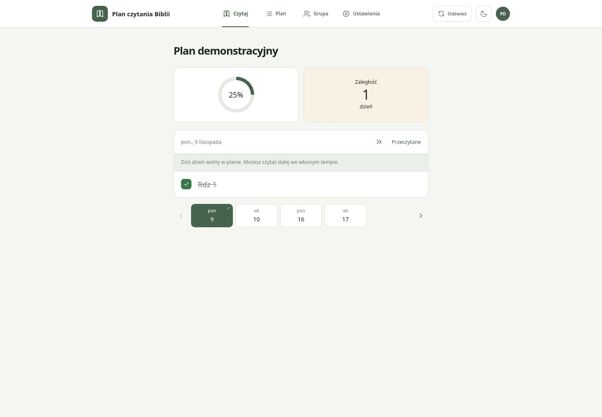 | 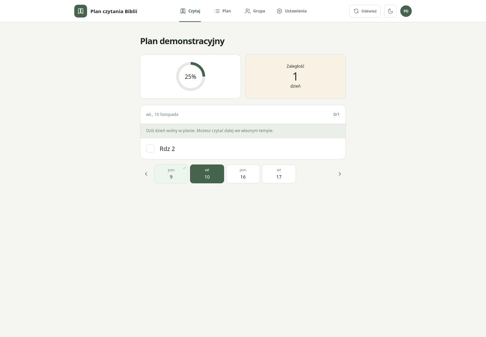 | 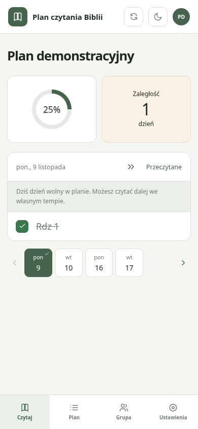 | 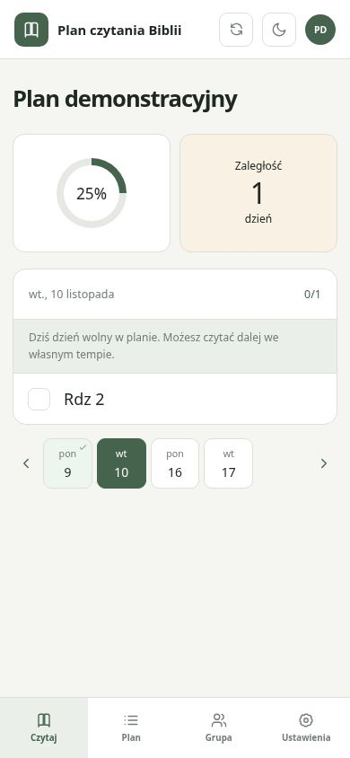 |
| partial | 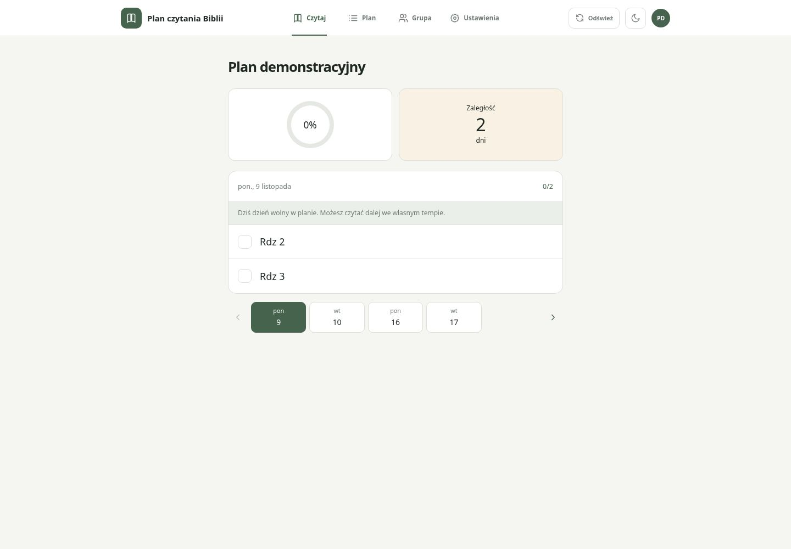 | 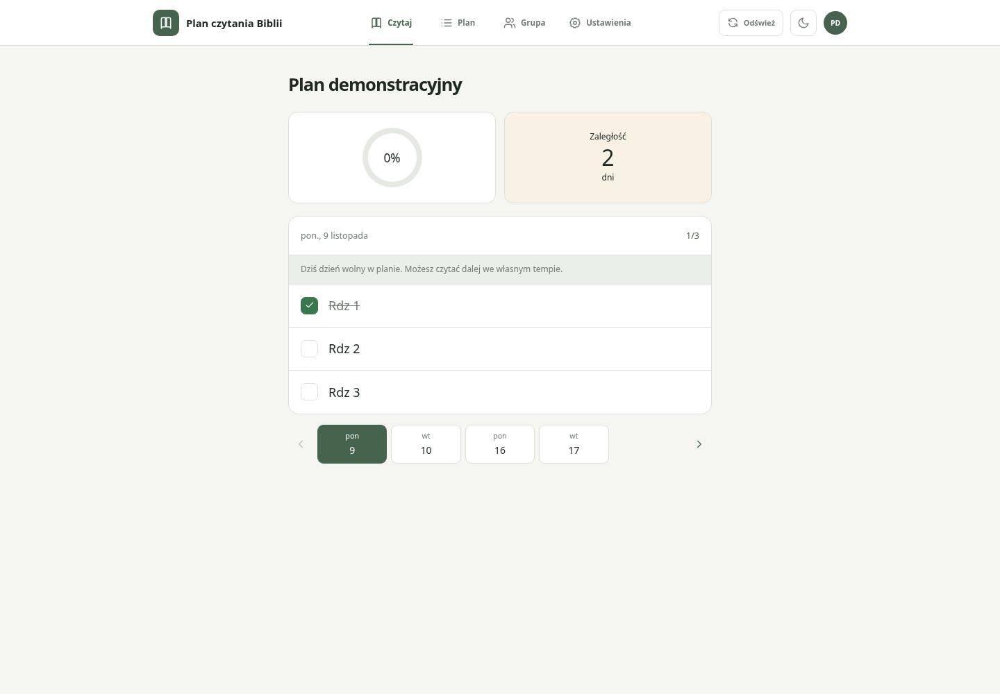 | 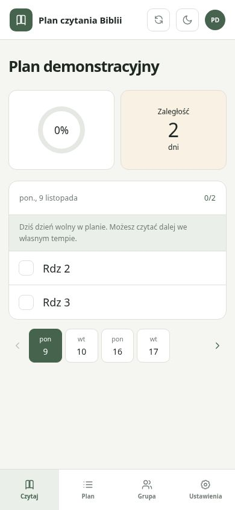 | 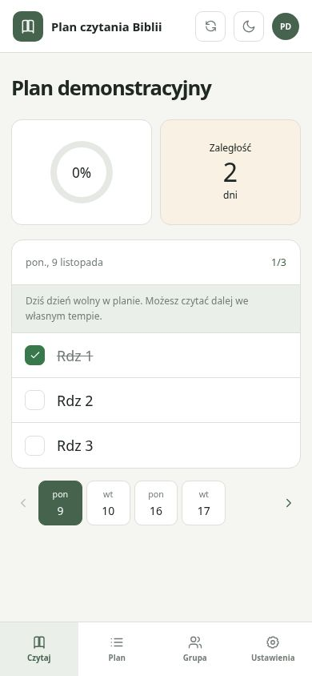 |
| recovery | 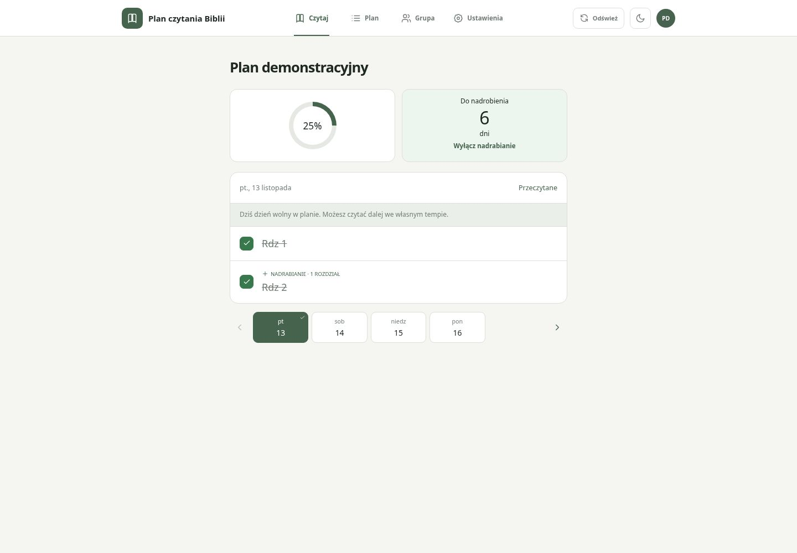 | 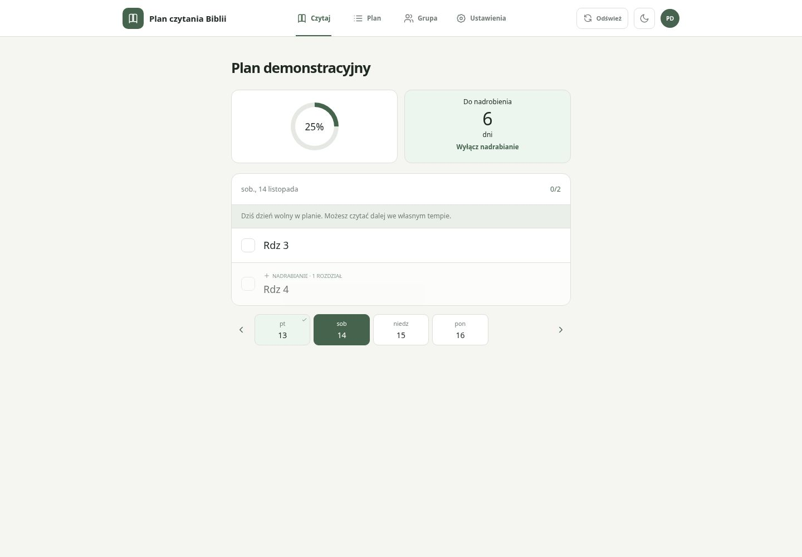 | 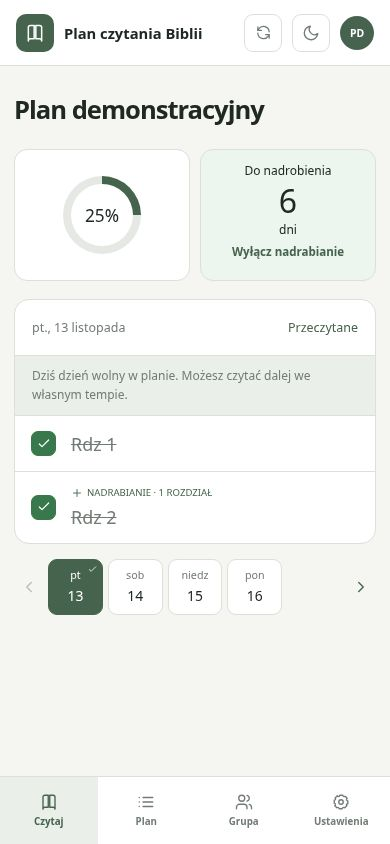 | 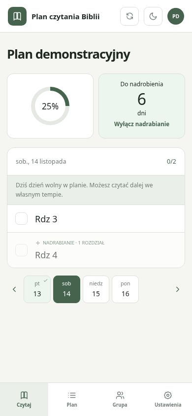 |

## Stany kontrolne po zmianie
| Stan | Desktop | Mobile |
|---|---|---|
| Czytanie do przodu | 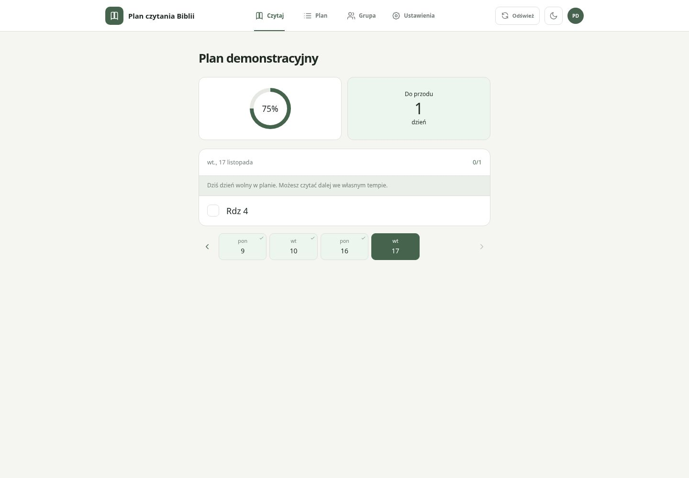 | 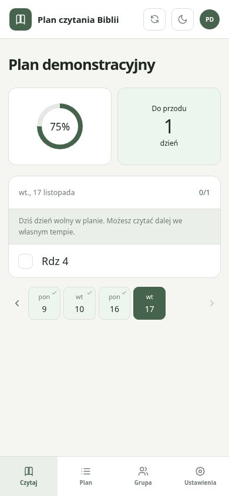 |
| Jawny link z powiadomienia | 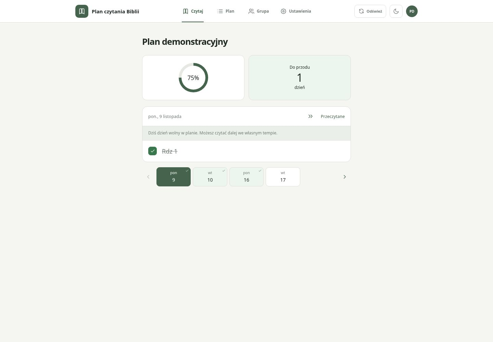 | 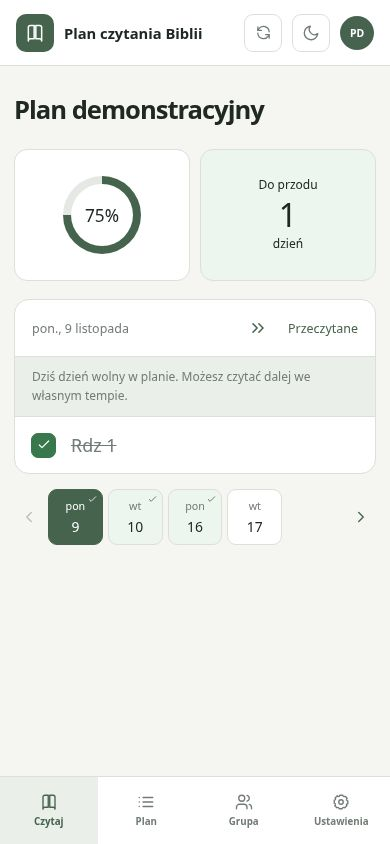 |

Lokalnie: **424 Vitest w 47 plikach + 21 testów Node oraz npm run build — sukces**.
Pokryto synchronizację po starcie, brak przeskoków po interakcji i zapisach,
powrót do swojego miejsca, częściowe rozdziały, osobisty rytm i dzień wolny,
zamrożone nadrabianie, jawne przejścia, nowy/ukończony plan.
Zmienione stare asercje dotyczyły świadomie zastąpionego zachowania po reload;
pozostawiono sprawdzanie zapisu, cofania odznaczeń, nawigacji i zachowania danych.

