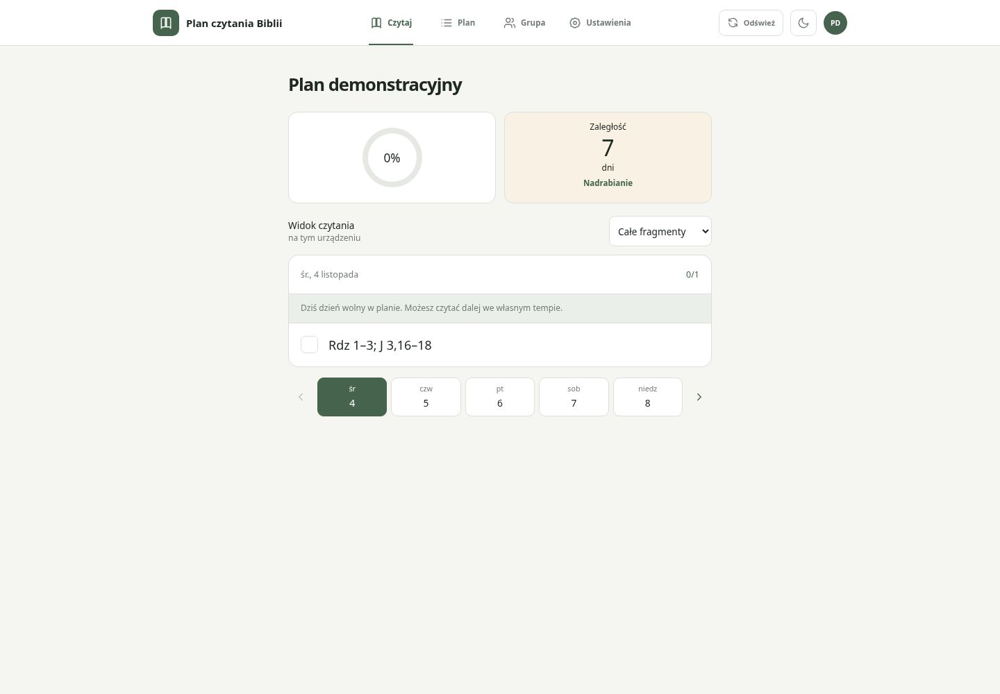
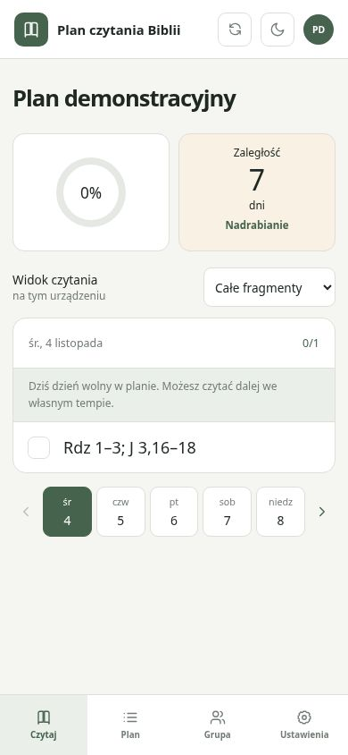
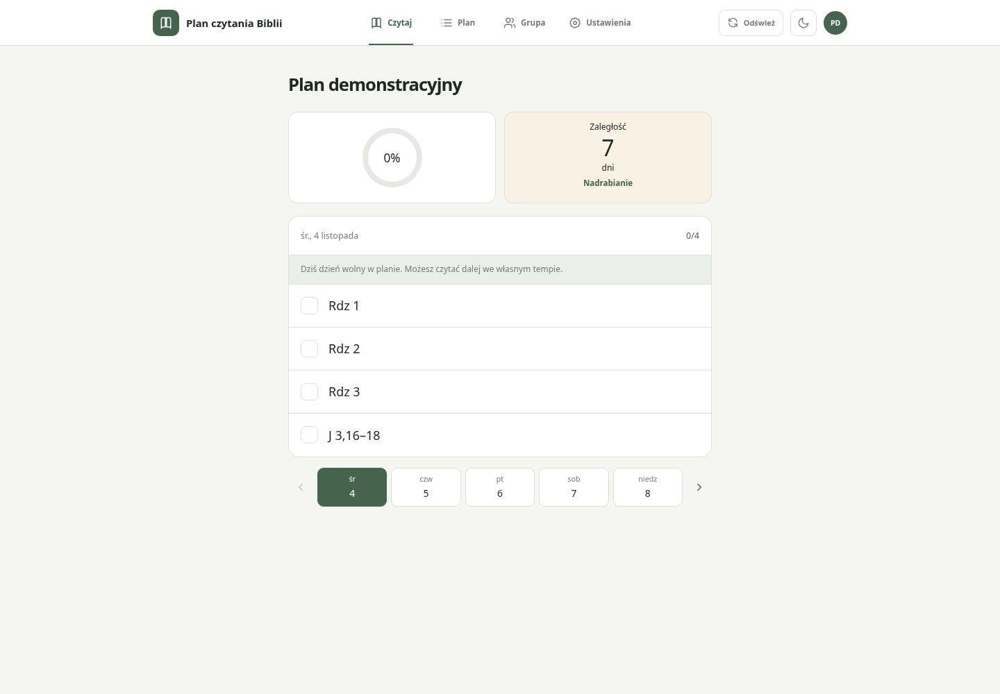
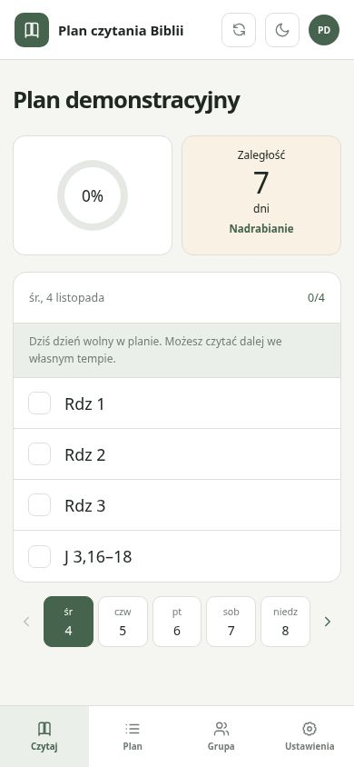
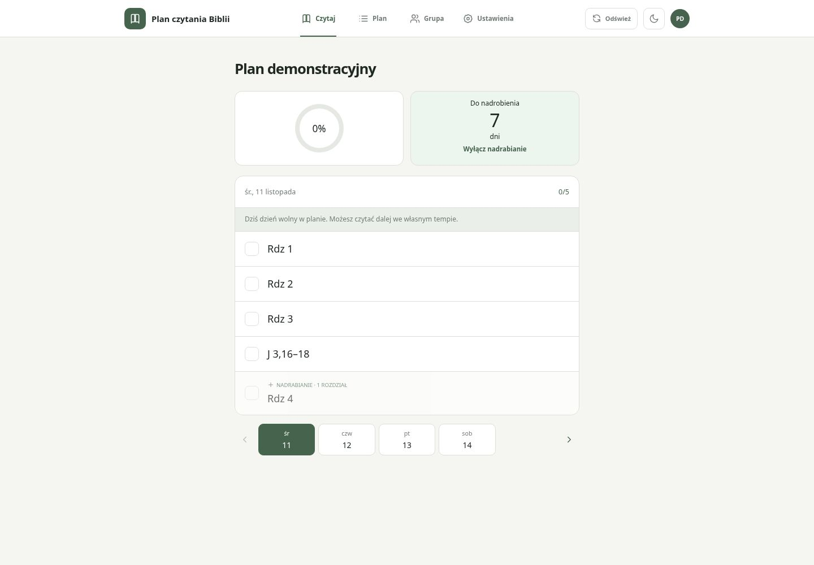
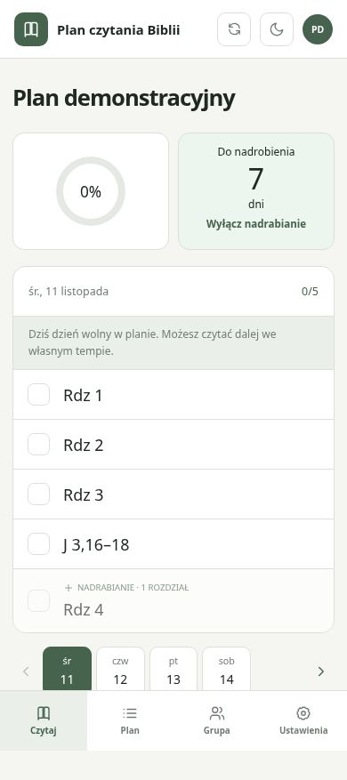
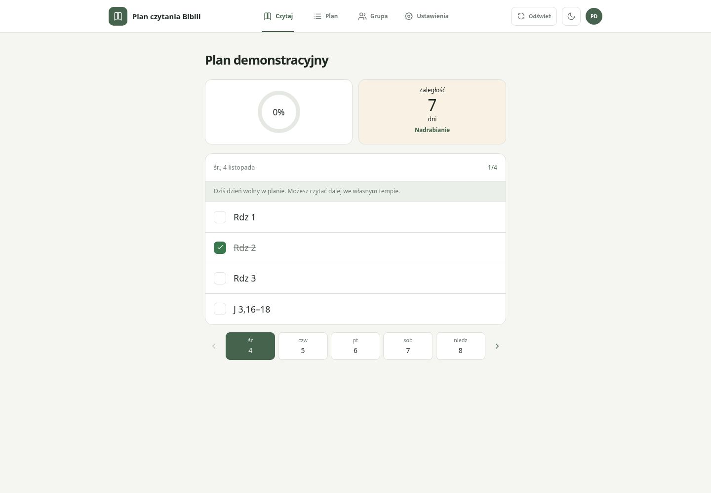

# Pojedyncze rozdziały — aktualny wynik #27

Dyspozycja właściciela z 11 listopada 2026: zawsze pokazuj pojedyncze rozdziały.
Nie ma przełącznika widoku na ekranie czytania, w ustawieniach ani przy włączaniu
nadrabiania. Stara preferencja urządzenia nie steruje prezentacją.
Precyzyjne zakresy wersetów pozostają niepodzielone, a niejasnych zapisów CSV
nie dzielimy na wymyślone rozdziały. Tożsamość zapisanych odznaczeń pozostaje zgodna.

Poniżej rzeczywiste zrzuty uruchomionej aplikacji Chromium, desktop 1440×1000,
mobile 390×844, pl-PL, Europe/Warsaw. Wszystkie dane są syntetyczne, bez prawdziwych
planów, osób i dostępu do produkcyjnego API. Zrzuty „before” pochodzą z
SHA e948b5c3b30b8bb3998b930270740981056d5a18 (poprzedni wybór widoku).
Zrzuty po zmianie odpowiadają kodowi bieżącego commita.

| Stan | Desktop | Mobile |
|---|---|---|
| Przed — wybór całych fragmentów |  |  |
| Zwykłe czytanie — osobne rozdziały |  |  |
| Nadrabianie — osobne rozdziały |  |  |
| Po wyłączeniu nadrabiania i odznaczeniu rozdziału |  |  |

Capture korzysta z istniejącego lokalnego trybu aplikacji: npm run dev na 5173,
lokalny fixture planu z siedmioma zaległymi czytaniami; Rdz 1–3 i J 3,16–18.
W UI wybierz Nadrabianie → Włącz, następnie Wyłącz nadrabianie i odznacz Rdz 2.
Stan przed odtworzono osobno z powyższego bazowego SHA. Nie ukrywano nakładek;
propozycję nadrabiania odrzucono rzeczywistą akcją Nie teraz, gdy była widoczna.

21 testów skryptów i 404 testy Vitest w 47 plikach oraz build — sukces.
Regresje E2E zaktualizowano, ale nie uruchamiano: obowiązuje pipeline po main.
Zrzuty i lokalne testy nie dowodzą produkcyjnego backendu.

Starsze obrazy fragments-*, chapters-* i recovery-* w tym katalogu są
historycznym dowodem reading-view-v1; nie przedstawiają aktualnego wymagania.
