# Tworzenie planu — dwa kroki (#26)

Rzeczywiste zrzuty Chromium uruchomionej lokalnej aplikacji. Desktop 1440×1000,
mobile 390×844, locale pl-PL, strefa Europe/Warsaw. Bez produkcyjnego API,
bez tworzenia planów i bez realnych danych; import synthetic.csv zawiera J 1/J 2.
Zrzuty nie dowodzą działania backendu. Zegar systemowy podczas capture: 10 listopada 2026;
daty aplikacji są obliczane dynamicznie. Obrazy „before” pochodzą dokładnie z bazowego
SHA e948b5c3b30b8bb3998b930270740981056d5a18. Obrazy po zmianie odpowiadają kodowi
tego commita; przy zmianie UI należy wykonać nowe zrzuty.

| Stan | Desktop | Mobile |
|---|---|---|
| Przed zmianą | 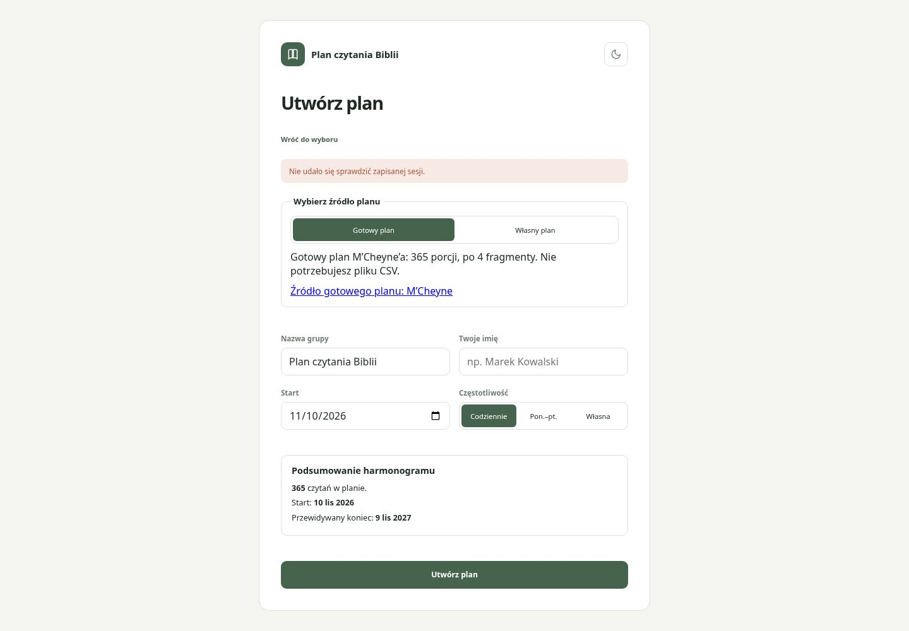 | 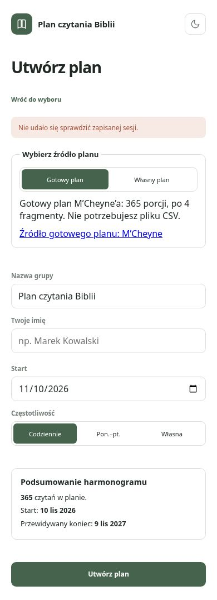 |
| Wybór planu | 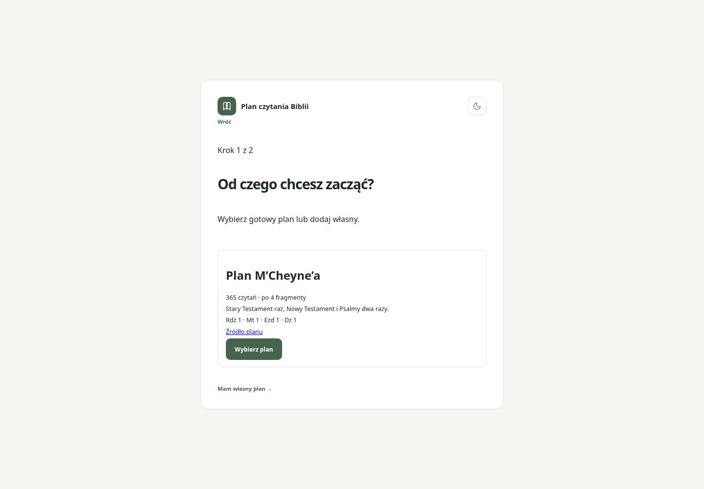 | 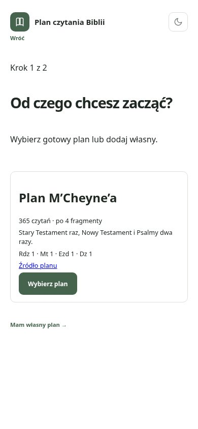 |
| Własny plan — pomoc zwinięta | 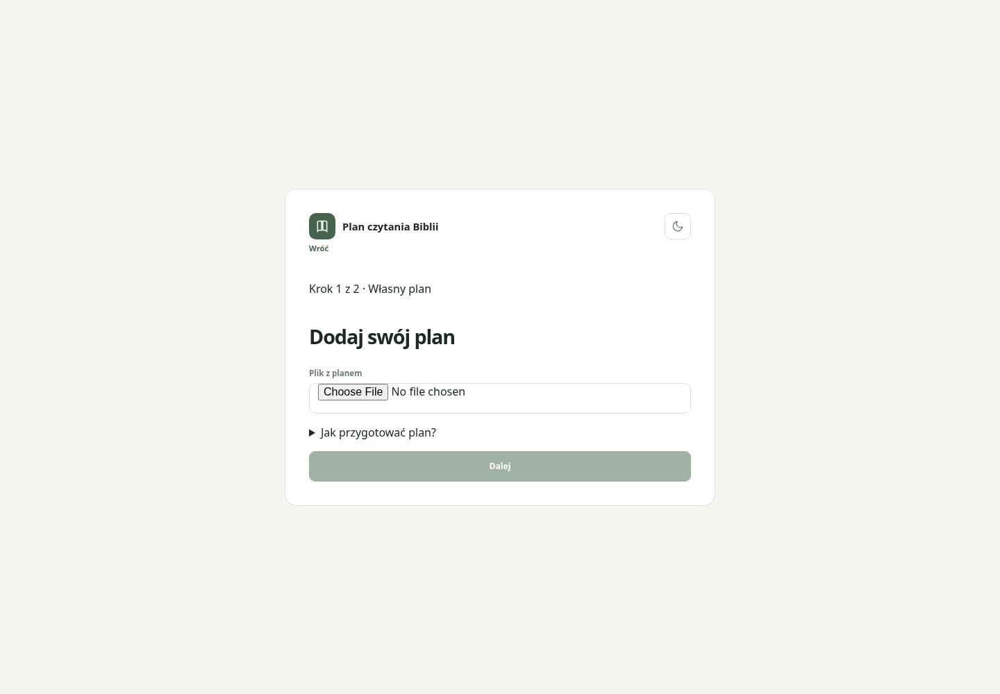 | 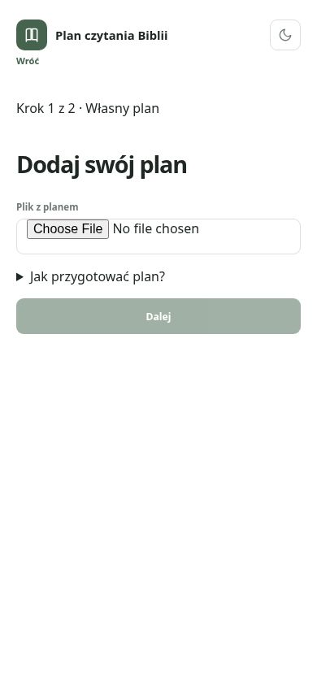 |
| Pomoc CSV i edytowalny prompt | 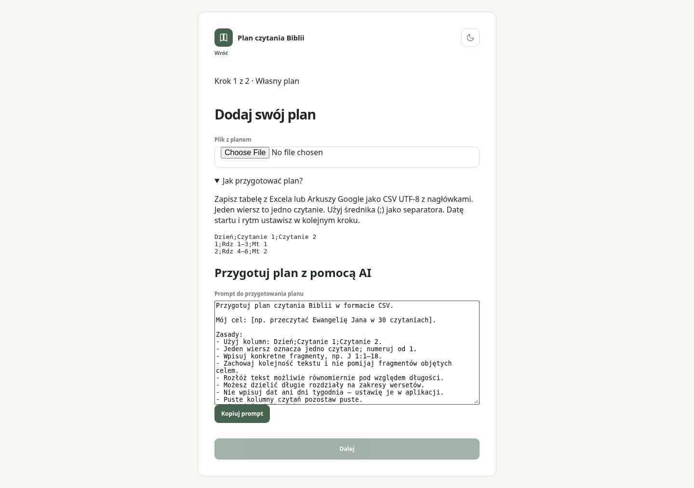 | 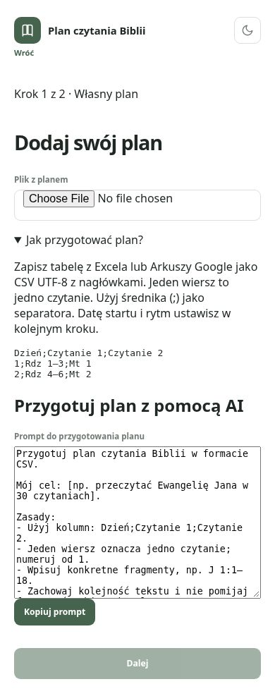 |
| Własny plan — podsumowanie | 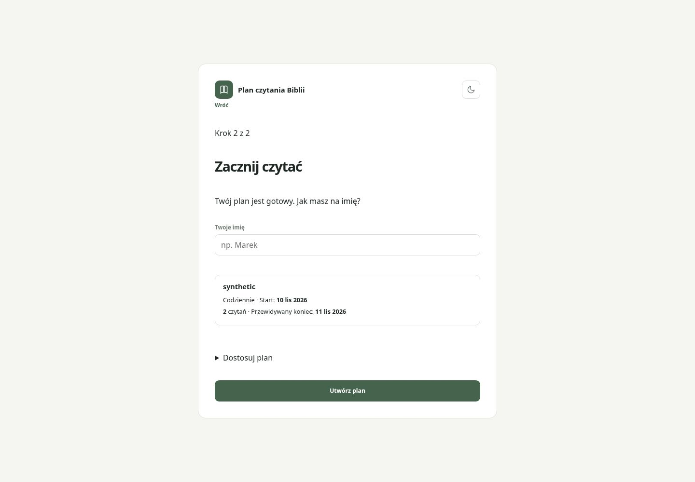 | 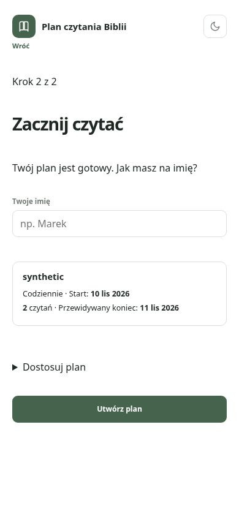 |
| Gotowy plan — imię | 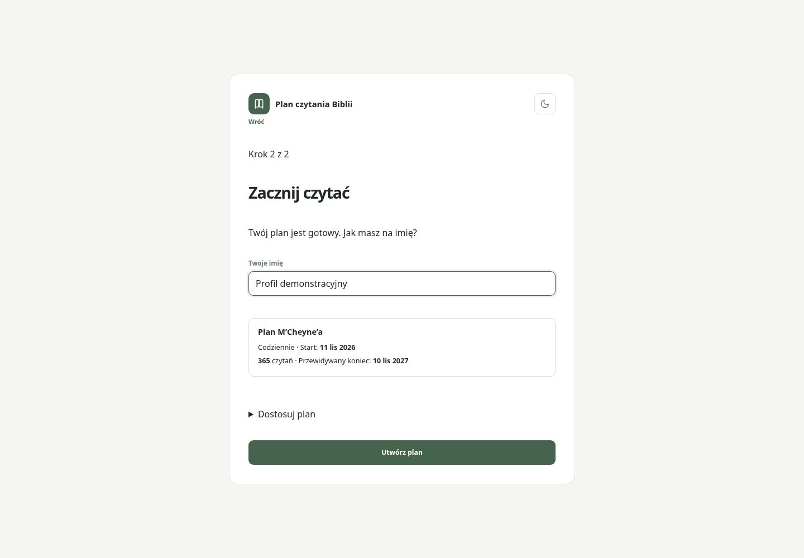 | 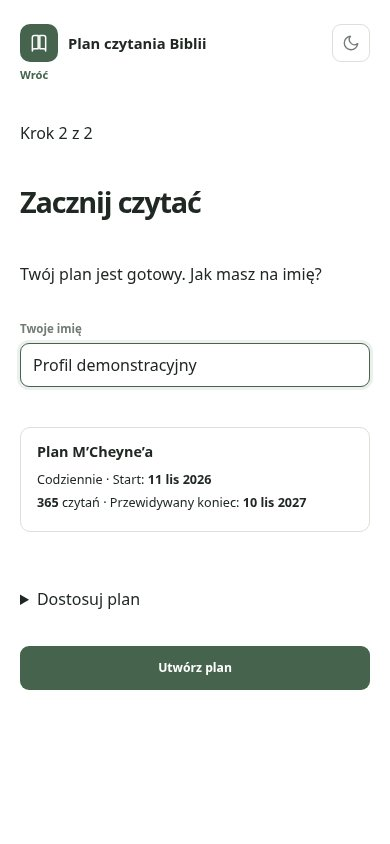 |
| Dostosowanie | 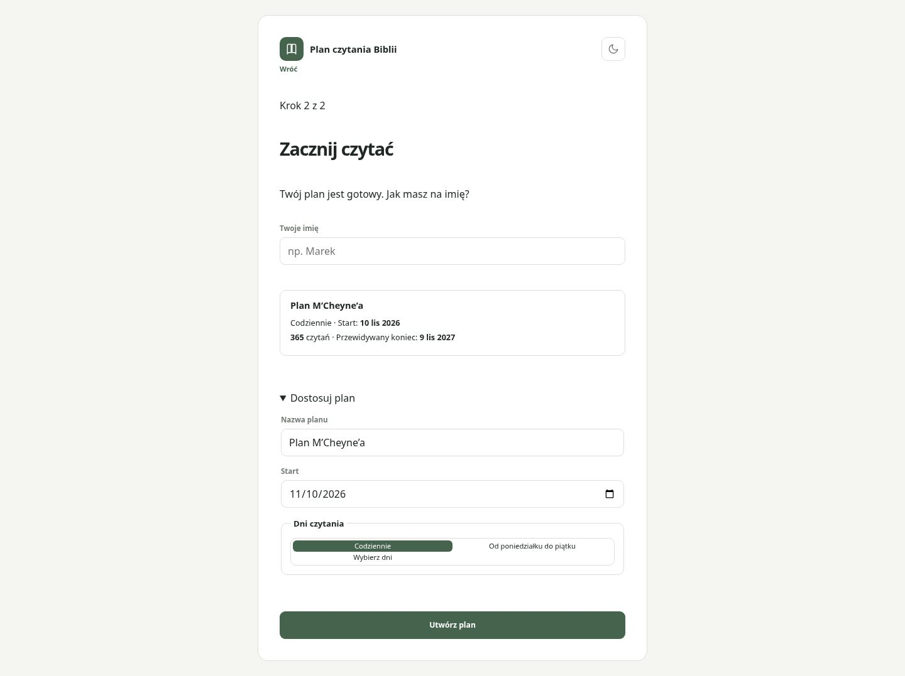 | 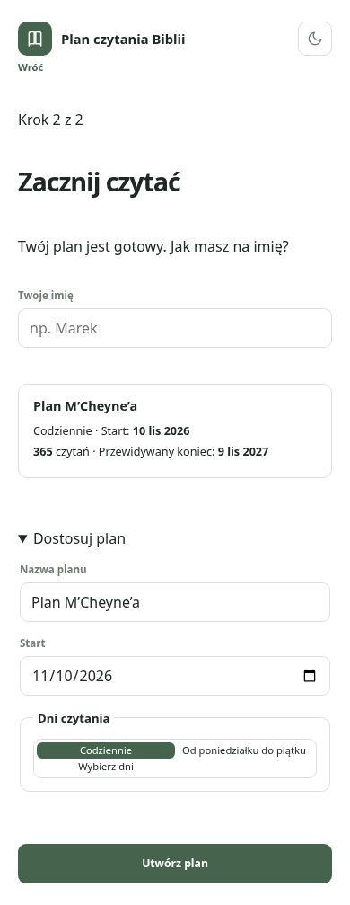 |

Reprodukcja: npm run dev; otwórz Utwórz plan. Wybierz plan lub Mam własny plan →,
rozwiń Jak przygotować plan?, zaimportuj syntetyczny CSV i przejdź Dalej. W kroku 2
rozwiń Dostosuj plan. Zrzuty przed zmianą: uruchom osobno powyższy bazowy SHA.

Weryfikacja lokalna: 21 testów Node, 385 testów Vitest i npm run build — sukces.
Scenariusze E2E zaktualizowano, lecz nie uruchomiono; wyłącznie istniejący pipeline po main.
