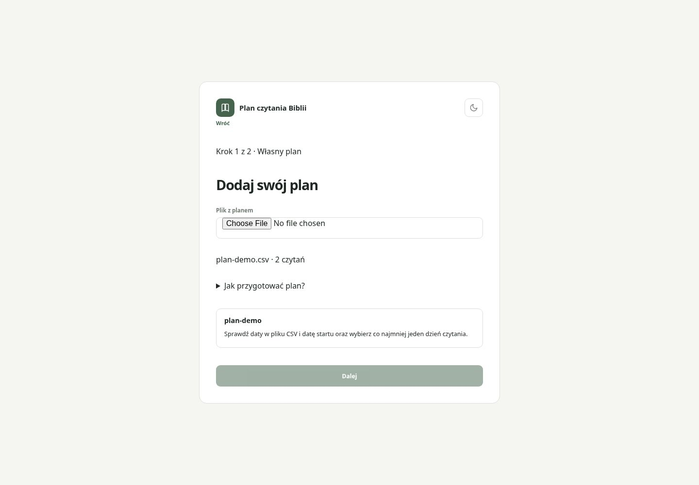
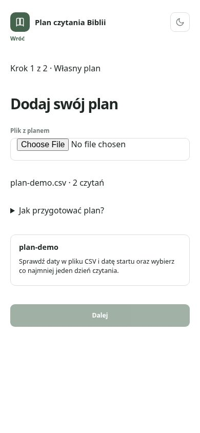
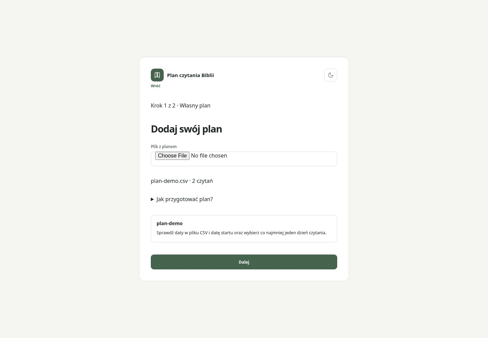
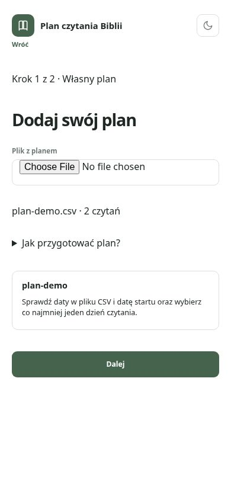
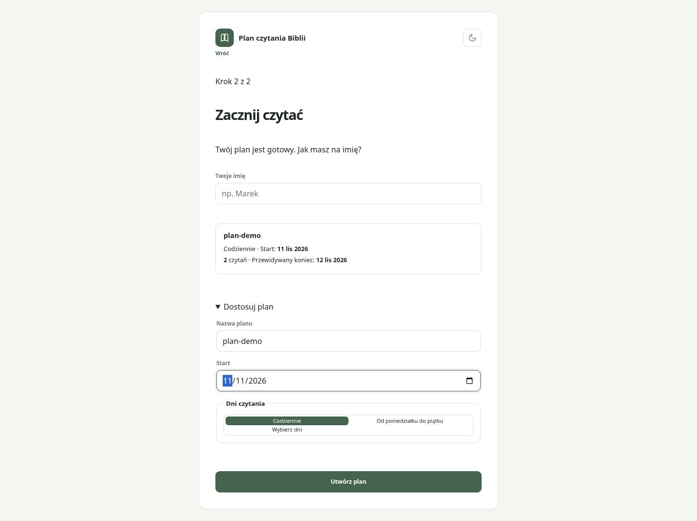
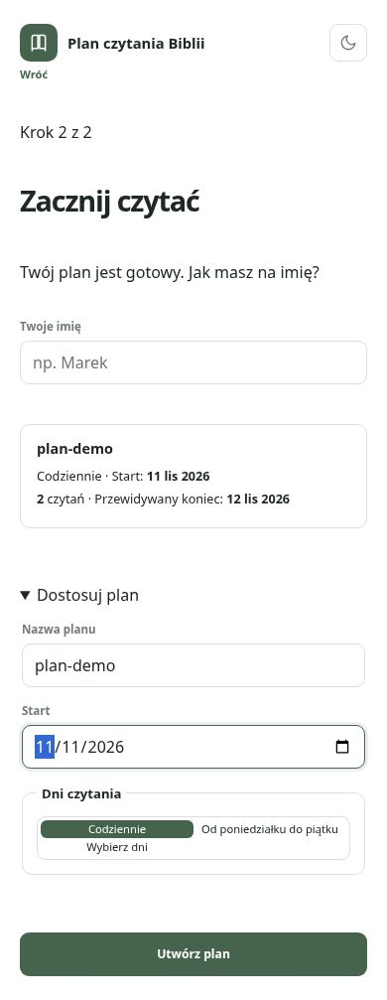
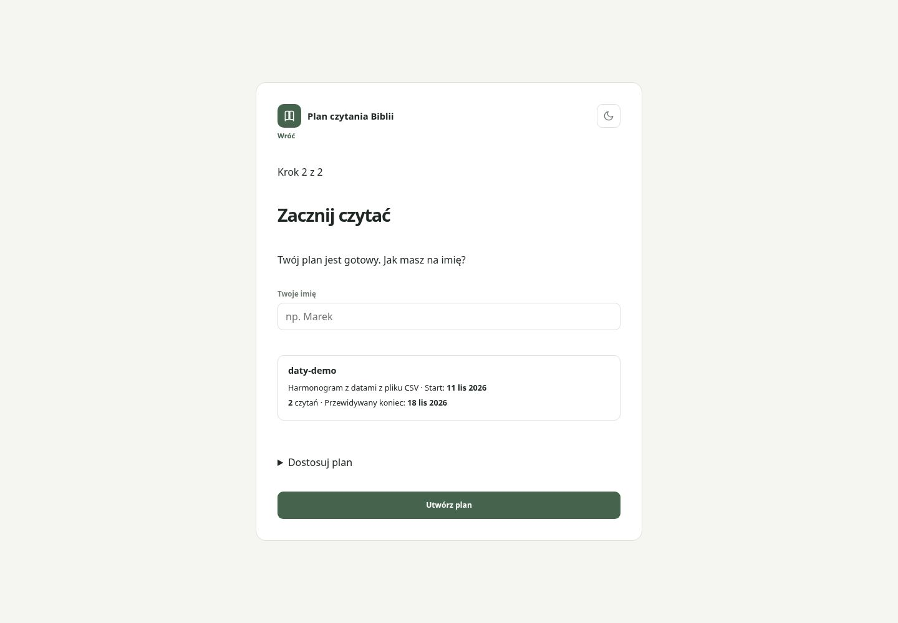
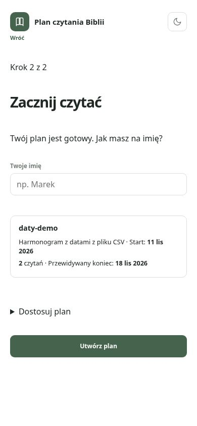

# Korekty review #26/#27 — runda 1

Rzeczywista lokalna aplikacja Chromium, desktop 1440×1000 / mobile 390×844,
pl-PL, Europe/Warsaw. Wyłącznie syntetyczny CSV J 1/J 2, bez tworzenia planu,
bez zapisów do backendu. Kadr „przed” z kodu f00cc55; „po” z kodu korekty
w tym commicie. Izolowany kod release uruchomiono na porcie 5173.

Naprawa #26: wgranie poprawnego CSV pozwala wrócić do kroku 2 również po
wyczyszczeniu daty lub wszystkich dni. Utworzenie planu pozostaje zablokowane,
dopóki użytkownik nie poprawi harmonogramu. CSV z jawnymi datami ma prawdziwy
opis „Harmonogram z datami z pliku CSV”, zamiast mylącego „Codziennie”.

| Stan | Desktop | Mobile |
|---|---|---|
| Powrót przed — zablokowane Dalej |  |  |
| Powrót po — dostępna naprawa |  |  |
| Harmonogram po poprawieniu daty |  |  |
| Opis jawnych dat CSV |  |  |

Naprawa #27: ostatni rozdział czeka na potwierdzenie zapisu, przy błędzie
pozostaje nieodznaczony i pozwala ponowić. Test jednostkowy sprawdza stan
oczekiwania, odrzucenie i udaną próbę. Regresja E2E obejmuje rzeczywisty 401
i opóźnioną odpowiedź. Stara zbiorcza asercja Rdz 2–3 została zastąpiona
sprawdzeniem obu osobnych rozdziałów. E2E nie uruchamiano poza pipeline.
Zwykłe czytanie, nadrabianie i częściowy postęp odtworzono ponownie na nowym
kodzie release; screenshoty always-chapters są bajtowo identyczne.

Lokalnie izolowany release: 21 Node + 389 Vitest (44 pliki) i build — sukces.
Develop z odrębnym #28: 21 Node + 408 Vitest (47 plików) i build — sukces.
Screenshoty nie dowodzą backendu produkcyjnego. Zmiany pozostają w zakresie
zatwierdzonego zachowania #26/#27 i nie obejmują ustawień #28.
